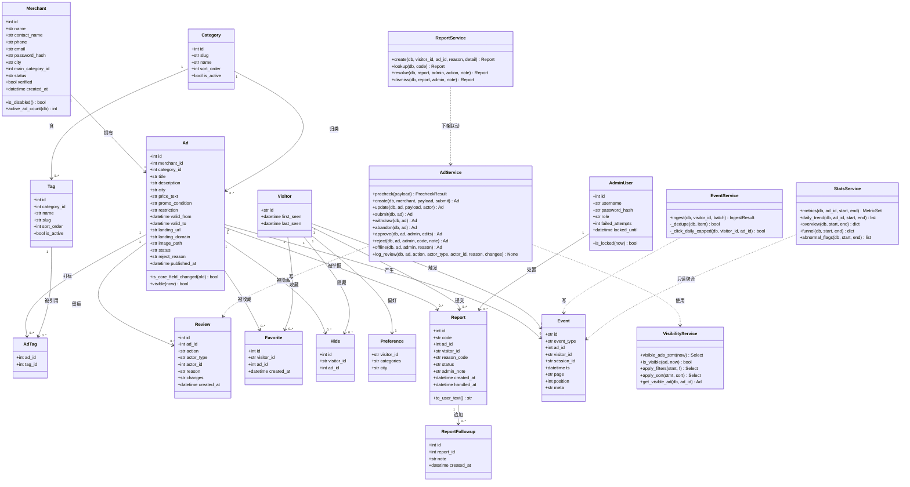
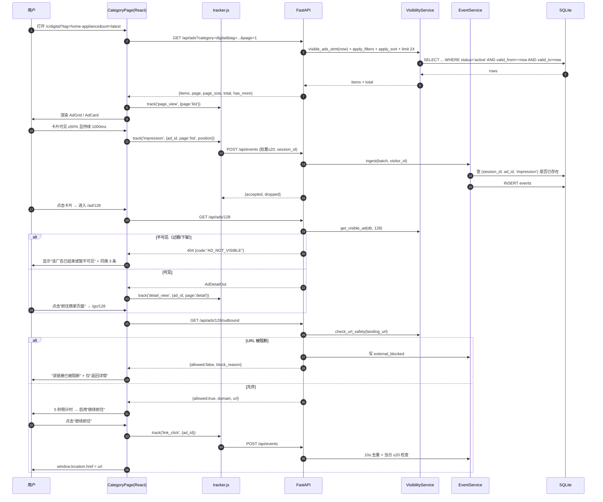
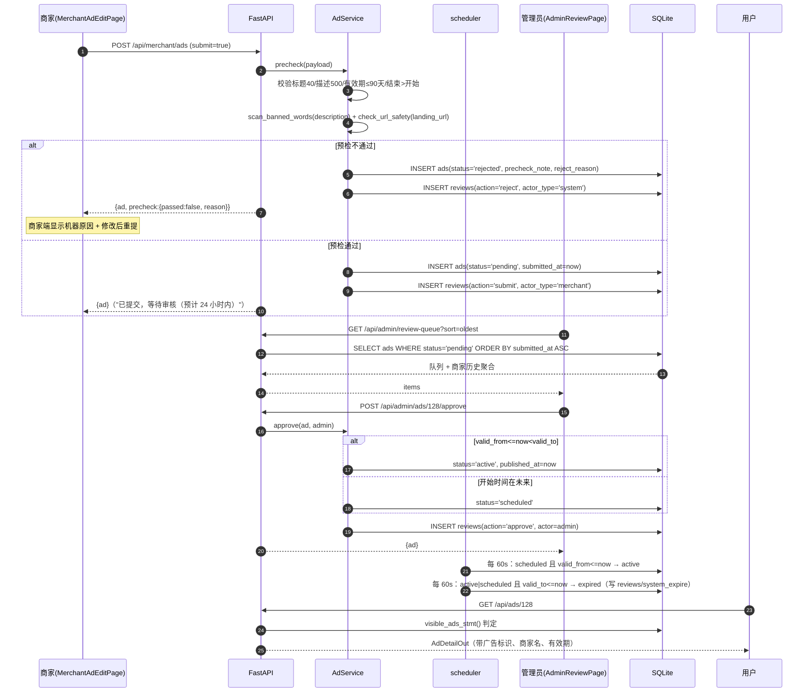
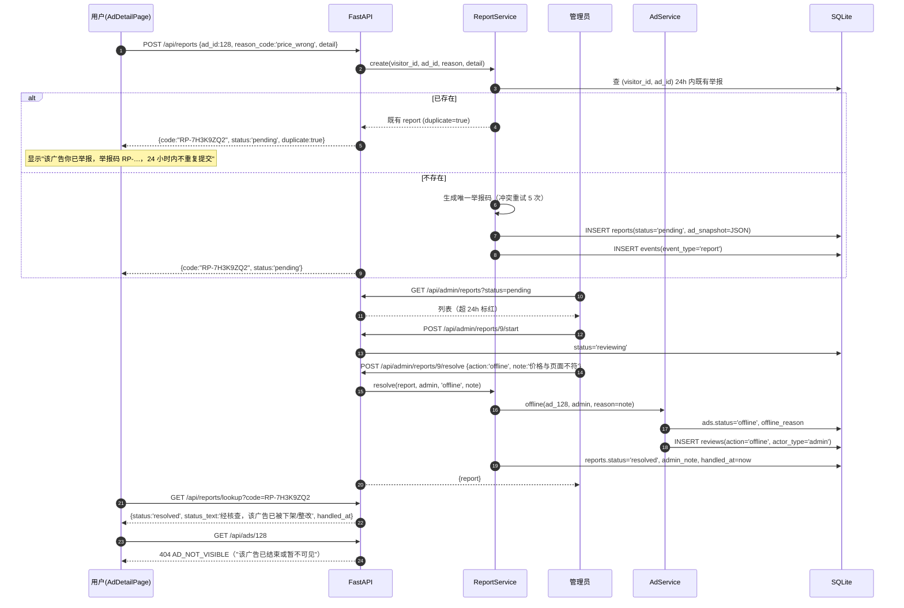

# 广告自主浏览与智能分类平台 · 系统架构设计（MVP）

| 项 | 内容 |
| --- | --- |
| 文档版本 | V1.0 / 2026-10-27 |
| 上游输入 | `docs/PRD.md`（V1.0，611 行，已定稿，本文件不推翻任何 PRD 结论，只做技术落地决策） |
| 架构师 | 高见远 |
| 实现目标 | PRD 全部 P0（43 条）+ 指定 P1（9 条），单端口同源部署，Windows 本地可跑 |
| 交付形态 | 后端 `backend/`（FastAPI + SQLAlchemy + SQLite）、前端 `frontend/`（React 18 + Vite 6 + MUI 6）、根级启动脚本与 README |

---

## 0. 本次实现范围（工程边界，先看这里）

### 0.1 必须实现：PRD P0 全部（43 条）

| 模块 | 需求编号 | 落点 |
| --- | --- | --- |
| 广告浏览 | P0-B-01 ~ P0-B-08 | 前端 `HomePage/CategoryPage/SearchPage/AdDetailPage/GoPage/PolicyPage` + `GET /api/ads`、`GET /api/ads/{id}`、`GET /api/ads/{id}/outbound` |
| 分类体系 | P0-C-01 ~ P0-C-03 | `categories/tags` 表 + `GET /api/categories` + 提交页标签选择约束 |
| 广告透明度 | P0-T-01 ~ P0-T-04 | `AdBadge` 组件 + `constants/messages.js` 精确文案 + 详情页商家块/有效期 |
| 用户控制 | P0-U-01 ~ P0-U-07 | `/api/visitor/favorites|hides|preferences` + `/api/reports` + `ReportDialog` + 上限 200/500 |
| 商家提交 | P0-M-01 ~ P0-M-06 | `/api/merchant/*` + 5 步表单 + 频控（日建 5 / 在架 20） |
| 运营审核 | P0-A-01 ~ P0-A-07 | `/api/admin/review-queue|approve|reject|edit-approve|offline` + `reviews` 留痕 |
| 账户与身份 | P0-S-01 ~ P0-S-03 | `visitor.py`（HMAC Cookie）+ JWT 双角色 + `deps.require_*` |
| 合规安全 | P0-K-01 ~ P0-K-05 | `utils/urlsafety.py` 预检 + `services/visibility.py` 双保险 + 无第三方请求 |

### 0.2 同时实现的 P1（9 条）

P1-E-01 事件埋点、P1-E-02 `/admin/stats` + CSV、P1-E-04 漏斗概览、P1-R-01 商家报告、P1-R-02 报告导出、P1-O-01 标签维护、P1-O-02 商家管理、P1-O-03 举报 SLA 提醒、P1-B-09 排序扩展（即将结束 / 最多收藏）。
附带实现 P1-E-03「疑似刷量」标记（它只是 `/admin/stats` 里的一条 SQL，成本近零，顺手做）。

### 0.3 明确不做（本轮）

- **全部 P2**：试点订单、人工支付登记、投放位说明、收藏清单分享、相似推荐模型化版本（详情页"同类广告"按 PRD 9.3 线框做**规则推荐**：同类别 + 同城市，属 P0-B-05 的"同类 3 条"要求，不是 P2-X-02 的完整形态）。
- **P1-S-04 匿名数据合并**、**P1-S-05 账号注销**：本轮不实现，数据库字段预留（`visitors` 表已足够支持后续合并，不额外建账号表）。
- 多级审核员角色（PRD 权限矩阵中 P1 的审核员）：只做 `admin` 单角色，`admin_users.role` 字段预留。

---

## 1. 技术选型与理由

| 层 | 选型 | 理由 / 偏差说明 |
| --- | --- | --- |
| Web 框架 | FastAPI 0.162 | PRD 已定。同时托管 API 与前端 dist，`lifespan` 可起后台协程做定时任务 |
| ORM | SQLAlchemy 2.1（2.0 声明式 `Mapped` / `mapped_column`） | 类型标注清晰；`create_all` 建表，**不引入 Alembic**（单人 MVP，改表就删 `data/adx.db` 重跑 seed） |
| DB | SQLite 单文件 `backend/data/adx.db` | PRD 已定。连接事件里 `PRAGMA journal_mode=WAL`、`foreign_keys=ON`、`busy_timeout=5000` |
| 校验 | Pydantic v2 + `pydantic-settings` | 请求体与 `ADX_*` 环境变量 |
| 密码哈希 | `passlib` 的 **`pbkdf2_sha256`**（29000 轮，自带随机盐） | **与 PRD 的文字偏差**：PRD P0-M-01 写"密码 bcrypt 存储"。实测本机 `bcrypt 5.0.0` 已移除 `__about__`，`passlib 1.7.4` 加载 bcrypt 后端直接抛 `AttributeError: module 'bcrypt' has no attribute '__about__'`（已复现）。`bcrypt 5.0` 还额外限制 >72 字节密码。为不引入兼容坑，采用同为"加盐慢哈希"的 `pbkdf2_sha256`，安全性等价（NIST 认可），满足"不存明文、不可逆、带盐"的实质要求。**不新增依赖**（passlib 已在 venv 内） |
| 令牌 | `PyJWT`，HttpOnly Cookie 承载 | 不用 Cookie Session（需 `itsdangerous`，未安装）。两个 Cookie：`adx_merchant` / `adx_admin`，payload `{sub, role, iat, exp}`，HS256 |
| 时区 | **固定偏移 `timezone(timedelta(hours=8))`**，不使用 `zoneinfo` | **实测坑**：本机 Windows + Python 3.13 **无 tzdata**，`zoneinfo.ZoneInfo("Asia/Shanghai")` 抛 `ZoneInfoNotFoundError`。中国无夏令时，固定 +8 偏移与 `Asia/Shanghai` 完全等价，零依赖 |
| 定时任务 | FastAPI `lifespan` + `asyncio.create_task` 循环，60s 一次 | 不引入 APScheduler（少一个依赖、少一类 Windows 事件循环坑）。任务内用同步 Session，异常必须捕获，避免协程死掉 |
| 前端 | React 18.3 + Vite 6 + MUI 6 + react-router-dom 6.28 | 全部已装。状态管理 **React Context + 自定义 hooks，不引入 redux** |
| 图标 | `components/icons.jsx` 内联 SVG | 不装 `@mui/icons-material`（需外网），不用 unicode 表情（跨平台渲染不一致） |
| 图片素材 | 后端 `utils/cover.py` 生成**确定性 SVG 封面** | 无外网、无图片素材。见 §1.1 |
| 图片处理 | 手写扩展名 + MIME + **魔数** + ≤2MB 校验，不做缩放 | **坑**：venv 无 Pillow，不能 `Image.open()`。前端用 `` + CSS 裁切解决尺寸问题 |
| CSV | 标准库 `csv` + `text/plain`→`text/csv`，UTF-8 **BOM** | Excel 打开中文不乱码 |
| 测试 | pytest + `fastapi.testclient`（底层 httpx 已装） | 只做冒烟 + 关键规则断言 |
| 字体 | 系统字体栈 | 不用 Google Fonts（外网） |

### 1.1 零素材视觉方案（重要，工程师别去找图）

1. `backend/utils/cover.py::generate_cover_svg(title: str, category_slug: str, ad_id: int) -> str`
   - 用 `hashlib.sha256(category_slug + title)` 取稳定种子 → 决定渐变色角度、两个几何图形（圆 / 三角 / 圆角矩形）位置与半径、色块透明度；
   - 色板按类别固定（6 组，均取自 PRD 设计基调的深蓝—青—灰绿系，强调橙不参与装饰）；
   - 画布 `800×450`（16:9），叠加类别中文名（`font-family="system-ui, 'Microsoft YaHei', sans-serif"`，SVG 内文字，无外链字体）+ 半透明遮罩，保证任何底色上叠白色 12px "广告"角标都清晰；
   - 返回 SVG 字符串，由 `seed.py` 写入 `backend/static/covers/ad-{ad_id}.svg`；商家新建广告未上传图片时，`AdService` 立即生成该文件并把路径写入 `ads.image_path`。
2. 前端 `` 直接引用 `/static/covers/ad-12.svg`；`onError` 时切到 CSS 占位块（灰底 + 内联 SVG 图形），**不留空白不塌陷**。
3. 商家上传的真实图片落在 `backend/static/uploads/{uuid}.{ext}`，路径 `/static/uploads/xxx.png`。
4. 结论：全站 0 个外链图片、0 个 CDN 请求，满足 P0-K-05。

---

## 2. 目录结构树（施工图，逐文件职责）

> 全部路径相对项目根 `AD/`。**任何文件内不得出现盘符或绝对路径**，路径计算规则见 §3.1。

```
AD/
├── README.md                                  # 启动/构建/初始账号/目录说明（唯一入口文档）
├── .gitignore                                 # node_modules、.venv、backend/data/*.db*、backend/.secret、frontend/dist、__pycache__
├── scripts/
│   ├── dev.ps1                                # 开发双进程：uvicorn --reload(8000) + vite(5173，代理 /api /static 到 8000)
│   ├── build.ps1                              # npm --prefix frontend run build + 打印 dist 产物信息
│   └── start.ps1                              # 生产单端口：构建（可选）+ uvicorn backend.main:app --port 8000
├── docs/
│   ├── PRD.md                                 # 已存在，不改
│   └── ARCHITECTURE.md                        # 本文件
├── backend/
│   ├── __init__.py                            # 空，包声明
│   ├── requirements.txt                        # 冻结现有依赖清单（pip freeze 摘录，含版本），便于重建环境
│   ├── config.py                               # Settings(BaseSettings)：ADX_ 前缀；secret 读取/自动生成 backend/.secret；db_path、cookie_secure、admin 初始账号、covers/uploads 目录推导
│   ├── database.py                             # engine / SessionLocal / Base / get_db() 依赖；connect 事件挂 PRAGMA(WAL, foreign_keys, busy_timeout)；ROOT_DIR/BACKEND_DIR/FRONTEND_DIST 常量
│   ├── constants.py                            # 城市 30+全国、报告原因 6、拒绝原因 6、禁投关键词、URL 黑名单/危险后缀、排序枚举、事件类型枚举、状态枚举、每页 24、频控阈值、类别色板
│   ├── models.py                               # 14 张表的 ORM 定义（唯一 models 文件，避免循环导入）
│   ├── security.py                             # pbkdf2 哈希/校验、JWT 签发/解码、Cookie 写入/清除、锁定判定（admin 5 次/15 分钟）
│   ├── visitor.py                              # adx_vid 的 base64url 生成、HMAC-SHA256 签名/校验、VisitorMiddleware（下发+校验+last_seen 10 分钟节流）
│   ├── deps.py                                 # get_db 之外的依赖：get_visitor_id、get_optional_merchant、require_merchant、get_optional_admin、require_admin、分页参数分页器、get_session_id
│   ├── scheduler.py                            # 后台协程：每 60s 执行 expire_to_invalid() + activate_scheduled()；启动即跑一次；全部 try/except + 结构化日志
│   ├── seed.py                                 # 幂等种子：6 类别 + 22 标签 + 1 管理员 + 8 商家 + ~51 条广告（含过期/待审/被拒样本）+ 生成全部封面 SVG + 演示事件（可选 --with-events）
│   ├── main.py                                 # app 装配：CORS(仅 dev)、异常处理器、VisitorMiddleware、include_router(全部)、/static 挂载、/assets 挂载、SPA fallback、lifespan 起 scheduler
│   ├── schemas/
│   │   ├── __init__.py                        # 统一导出
│   │   ├── common.py                          # ApiError 结构、Page[T] 泛型分页、OkOut、IdOut、BaseORMModel(from_attributes)
│   │   ├── auth.py                            # MerchantSignupIn/LoginIn/MerchantOut/PasswordChangeIn/AdminLoginIn/AdminOut
│   │   ├── ad.py                              # AdCardOut/AdDetailOut/AdCreateIn/AdUpdateIn/AdListOut/RelatedAdOut/OutboundOut/AdPrecheckOut
│   │   ├── category.py                        # CategoryOut（含 tags + active_count）、TagOut、TagCreateIn、TagUpdateIn
│   │   ├── visitor.py                         # VisitorMeOut/FavoriteIn/FavoriteOut/HideIn/PreferenceIn/PreferenceOut/ReportIn/ReportOut/ReportLookupOut/FollowupIn
│   │   ├── event.py                           # EventItemIn/EventBatchIn/EventAcceptedOut
│   │   ├── admin.py                           # ReviewQueueItemOut/ApproveIn/RejectIn/EditApproveIn/OfflineIn/AdminAdRowOut/AdminReportRowOut/ResolveIn/DismissIn/MerchantRowOut/MerchantStatusIn/AdminSummaryOut
│   │   └── stats.py                           # MetricSet/AdStatRow/CategoryStatRow/TrendPoint/FunnelOut/StatsOverviewOut
│   ├── utils/
│   │   ├── __init__.py                        # 空
│   │   ├── timeutil.py                        # CST(+8) 常量、now_utc()、utc_to_iso_z()、to_cst()、cst_date_str()、parse_cst_date_start/end()、days_left()、is_expiring_soon()、today_cst_range_utc()
│   │   ├── urlsafety.py                       # normalize_url()、check_url_safety() -> (ok, reason_code, reason_text, domain)；禁投词 scan_banned_words()
│   │   ├── cover.py                           # generate_cover_svg() + write_cover_file()
│   │   └── csv_export.py                      # csv_response(rows, header, filename)：BOM + RFC5987 中文文件名
│   ├── services/
│   │   ├── __init__.py                        # 空
│   │   ├── visibility.py                      # visible_ads_stmt()（唯一权威可见性条件）、is_visible()、apply_filters()、apply_sort()、get_visible_ad()、hydrate_card()
│   │   ├── ads.py                             # AdService：create/update/submit/withdraw/abandon/duplicate/precheck/核心字段判定/频控/图片校验落盘/review 留痕
│   │   ├── events.py                          # EventService.ingest()：逐条校验+去重（6 类规则）+ link_click 日限 20，返回 accepted/dropped
│   │   ├── reports.py                         # ReportService：创建（24h 合并+举报码重试）、按码查询、我的举报、追加说明、管理员处置联动广告状态
│   │   └── stats.py                            # StatsService：metrics(ad,from,to)、daily_trend、overview、funnel、abnormal_flags、merchant_report、merchant_summary_counts
│   ├── routers/
│   │   ├── __init__.py                        # 汇总 API_ROUTERS 列表
│   │   ├── meta.py                            # GET /api/meta（城市/原因/状态字典/类别色板）；GET /api/health
│   │   ├── public_categories.py               # GET /api/categories
│   │   ├── public_ads.py                      # GET /api/ads、/api/ads/{id}、/api/ads/{id}/related、/api/ads/{id}/outbound
│   │   ├── events.py                          # POST /api/events
│   │   ├── visitor.py                         # /api/visitor/me、favorites、hides、preferences、DELETE data
│   │   ├── reports.py                         # POST /api/reports、GET /api/reports/mine、GET /api/reports/lookup、POST /api/reports/{code}/followup
│   │   ├── merchant_auth.py                   # signup/login/logout/me/password
│   │   ├── merchant_ads.py                    # 我的广告 CRUD + 状态迁移动作 + 图片上传
│   │   ├── merchant_report.py                 # GET /api/merchant/report + /export.csv
│   │   ├── admin_auth.py                      # 登录/登出/me
│   │   ├── admin_review.py                    # 队列 + approve/reject/edit-approve/offline + reviews 时间线
│   │   ├── admin_ads.py                       # 广告台账列表/详情/操作历史/批量下架
│   │   ├── admin_reports.py                   # 举报列表/开始处理/成立/驳回/近 7 天统计
│   │   ├── admin_merchants.py                 # 商家列表/停用启用/核验标记/备注
│   │   ├── admin_categories.py                # 标签 CRUD（一级类别只读）
│   │   └── admin_stats.py                     # overview/funnel/export.csv + 运营首页 summary
│   ├── tests/
│   │   ├── __init__.py                        # 空
│   │   ├── conftest.py                        # 临时 DB（ADX_DB_PATH 指向 tmp）+ 造数 fixture + client
│   │   └── test_smoke.py                      # 冒烟：健康检查/可见性/状态机/事件去重/权限 401/URL 阻断/举报合并
│   ├── static/
│   │   └── covers/.gitkeep                    # seed 生成的 ad-*.svg 落此
│   │   └── uploads/.gitkeep                   # 商家上传图落此
│   └── data/.gitkeep                          # adx.db / adx.db-wal / adx.db-shm 落此（已 gitignore）
└── frontend/
    ├── package.json                           # 已存在；仅补 "start" 脚本与服务端字段（不新增依赖）
    ├── vite.config.js                         # @vitejs/plugin-react；base:'/'；build.outDir='dist'；server.proxy 把 /api /static 打到 127.0.0.1:8000（dev 用）
    ├── index.html                             # title="广告发现站｜广告自主浏览"，meta description、lang="zh-CN"、内联 critical CSS 防闪烁
    └── src/
        ├── main.jsx                           # createRoot + BrowserRouter + ThemeProvider + CssBaseline + 各 Context Provider + App
        ├── App.jsx                            # AppLayout（顶栏/通知条/页脚）+ <Routes>（来自 routes.jsx）
        ├── routes.jsx                         # 完整路由表（含 lazy 占位），T08–T11 逐条替换占位
        ├── theme.js                           # MUI 主题：palette(primary #1F3A5F / secondary #E8590C / bg #F7F8FA)、字号、圆角 12、阴影、组件默认 props（Button 去大写、Card 无阴影抬升）
        ├── styles/global.css                  # 字体栈、scrollbar、prefers-reduced-motion、.adx-card-img object-fit、窄屏角标不裁切、骨架屏动画
        ├── api/
        │   ├── client.js                      # request()：同源 fetch、credentials:'same-origin'、query 序列化、{detail,code} → ApiError、401 广播事件、CSV 下载
        │   ├── public.js                      # getMeta/getCategories/getAds/getAdDetail/getRelated/getOutbound
        │   ├── events.js                      # postEvents(batch)（sendBeacon 优先，失败降级 fetch）
        │   ├── visitor.js                     # getMe/collect favorites/hides/preferences/clearAll + report 相关
        │   ├── merchant.js                    # 商家端全部接口封装（含 multipart 上传、CSV 下载）
        │   └── admin.js                       # 管理端全部接口封装（含 CSV 下载）
        ├── constants/
        │   ├── enums.js                       # AD_STATUS / REPORT_STATUS / SORT_OPTIONS 及中文标签与色值映射
        │   ├── messages.js                    # PRD 6.3 精确文案常量（AD_BADGE="广告"、CTA="前往商家页面"、LEAVE_HINT="即将离开本平台"、GO_TITLE="您即将离开本站" 等）
        │   ├── cities.js                      # 兜底城市数组（以 /api/meta 为准，此文件仅离线兜底）
        │   └── reasons.js                     # 举报原因 6 项、拒绝原因 6 项（code + label，兜底）
        ├── utils/
        │   ├── format.js                      # formatDateCN/formatRangeCN/daysLeftText/endingSoonText/countText/percentText/rateText（必带分母）
        │   └── url.js                         # buildQuery/parseQuery/canonicalListPath
        ├── tracker/
        │   └── index.js                       # 单例队列：sessionId 管理、track()、阈值 20 或 3s 空闲 flush、页面隐藏 flush、失败静默
        ├── hooks/
        │   ├── useApi.js                      # 通用 {data,loading,error,reload}
        │   ├── useAdsList.js                  # 列表分页累加 + 加载更多 + 去重 + has_more
        │   ├── useListQuery.js                # URL query ↔ 筛选状态双向同步（tag/city/ending/promo/sort/page/q）
        │   └── useTrackImpression.js          # IntersectionObserver(0.5)+1000ms 定时，每挂载 1 次
        ├── context/
        │   ├── ToastContext.jsx               # toast 队列 + Toast 渲染位；showToast(msg, level)
        │   ├── VisitorContext.jsx             # visitorId、favorites Set、hides Set、preferences、上限判定、toggleFavorite/hide/unhide/savePrefs/clearAll
        │   ├── AuthContext.jsx                # role('merchant'|'admin'|null)、me、login/logout/probe、401 监听自动跳登录
        │   └── CategoriesContext.jsx          # /api/categories 一次性缓存 + getCategory(slug)/getTag(slug)
        ├── components/
        │   ├── icons.jsx                      # 内联 SVG：Search/Star/StarFilled/More/Close/ChevronLeft/ChevronRight/External/Shield/Report/Check/Warn/Download/Logout/Clock
        │   ├── AppLayout.jsx                  # 用户端骨架：Header + NoticeBar + <Outlet/> + Footer
        │   ├── Header.jsx                     # Logo、搜索框（回车跳 /search）、收藏、偏好；窄屏折叠
        │   ├── Footer.jsx                     # 政策/关于链接 + "本站不参与交易"常驻说明
        │   ├── NoticeBar.jsx                  # 首页顶部说明条（关闭后 localStorage 记 7 天）
        │   ├── AdBadge.jsx                    # "广告"角标（实底橙 + 白字 12px 加粗 + 圆角 4 + 距边 8px，永不随 hover 消失）
        │   ├── AdCard.jsx                     # 卡片：图/角标/标题 2 行/商家/价格/城市/有效期或即将结束/收藏/更多菜单（隐藏、举报）；preview 模式供商家表单实时预览
        │   ├── AdGrid.jsx                     # 响应式网格 1/2/3 列（CSS Grid，不用 MUI Grid）
        │   ├── LoadMore.jsx                   # "加载更多" / "没有更多了"
        │   ├── EmptyState.jsx                 # 统一空态（标题/说明/动作按钮/推荐类别）
        │   ├── FilterBar.jsx                  # 城市下拉 + 有效期下拉 + 是否有优惠 + 清除筛选
        │   ├── TagScroll.jsx                  # 二级标签横滑单选条
        │   ├── SortSelect.jsx                 # 排序选择器（最新发布/即将结束/最多收藏）
        │   ├── StatusChip.jsx                 # 广告/举报状态彩色标签（颜色映射来自 enums.js）
        │   ├── Pagination.jsx                 # 管理端表格分页
        │   ├── ConfirmDialog.jsx              # 二次确认（清除偏好、下架等）
        │   ├── ReportDialog.jsx               # 举报弹窗：原因单选 + 说明 ≤200 + 提交后展示举报码
        │   ├── Toast.jsx                      # 轻量提示（读 ToastContext）
        │   ├── StatCard.jsx                   # 指标卡（数字 + 口径 tooltip，禁止裸"点击率"）
        │   ├── RequireAuth.jsx                # 路由守卫（role 校验，未登录跳对应登录页）
        │   ├── MerchantLayout.jsx             # 商家端侧/顶导航 + 登出
        │   └── AdminLayout.jsx                # 后台顶栏（待审数/举报数/超时数徽标）+ 侧边导航
        └── pages/
            ├── HomePage.jsx                   # P0-B-01：说明条 + 搜索 + 6 类别入口（在架数）+ 最新 12 条
            ├── CategoryPage.jsx               # P0-B-02：面包屑 + 标签横滑 + 筛选 + 排序 + 网格 + 加载更多
            ├── SearchPage.jsx                 # P0-B-03：回填搜索框 + 结果数 + 复用列表组件 + 空态建议
            ├── AdDetailPage.jsx               # P0-B-05：全字段 + 广告标识 + 外链按钮 + 收藏/隐藏/举报 + 商家块 + 同类 3 条 + 不可见态
            ├── GoPage.jsx                     # P0-B-07：域名/完整 URL/5s 倒计时/继续前往/返回详情/阻断态
            ├── FavoritesPage.jsx              # P0-U-01：收藏网格 + 批量取消 + "已结束"分组 + 本设备提示
            ├── PreferencesPage.jsx            # P0-U-02/03/07：类别多选、常看城市、已隐藏（可恢复）、清除全部（二次确认）
            ├── ReportStatusPage.jsx           # P0-U-04/05：举报码查询 + 本设备举报列表 + 状态文案
            ├── PolicyPage.jsx                 # P0-B-08：/policy/ads|privacy|report、/about 四篇正文（含 #why 锚点）+ 目录
            ├── NotFoundPage.jsx               # 404 兜底
            ├── merchant/
            │   ├── MerchantLoginPage.jsx      # 登录（账号=邮箱或手机）
            │   ├── MerchantSignupPage.jsx     # 注册即入驻 + 政策勾选
            │   ├── MerchantAdsPage.jsx        # 我的广告：状态分页签 + 列表 + 被拒原因展开 + 新建/撤回/复制
            │   ├── MerchantAdEditPage.jsx     # 5 步表单 + 实时预览 + 字段级校验 + 保存草稿/提交审核
            │   ├── MerchantReportPage.jsx     # 广告选择 + 日期区间 + 4 指标 + 按日趋势 + 导出 CSV
            │   └── MerchantProfilePage.jsx    # 资料 + 改密码
            └── admin/
                ├── AdminLoginPage.jsx         # 登录 + 锁定提示
                ├── AdminDashboardPage.jsx     # 运营首页：待审/待处理举报/超时举报/今日事件/快捷入口
                ├── AdminReviewPage.jsx        # 审核队列（左列表 + 右详情 + 预检结果 + 商家历史 + 三种动作）
                ├── AdminAdsPage.jsx           # 广告台账：筛选/搜索/操作历史/下架/整改重提
                ├── AdminReportsPage.jsx       # 举报处理：状态页签/超时高亮/开始处理/成立/驳回/结论
                ├── AdminMerchantsPage.jsx     # 商家列表/停用启用/核验/备注/高风险标记
                ├── AdminCategoriesPage.jsx    # 6 类别只读 + 标签新增改名排序停用
                └── AdminStatsPage.jsx         # 日期区间/总览/广告排行/类别分布/漏斗/异常标记/导出
```

**文件统计**：后端 52 个代码文件 + 3 个 `data|static` 占位；前端 75 个文件（含已存在的 `package.json`）；根级 5 个；文档 2 个。

---

## 3. 关键工程约束（照做，不要发挥）

### 3.1 路径推导（唯一写法）

```python
# backend/database.py
BACKEND_DIR = Path(__file__).resolve().parent          # backend/
ROOT_DIR = BACKEND_DIR.parent                          # AD/
FRONTEND_DIST = ROOT_DIR / "frontend" / "dist"
DB_PATH = BACKEND_DIR / "data" / "adx.db"              # 可被 ADX_DB_PATH 覆盖（测试用）
STATIC_DIR = BACKEND_DIR / "static"
```

禁止：`C:\...`、`F:/...`、`os.getcwd()` 拼接、`../../` 字符串硬编码。前端禁止 `http://localhost:8000` 硬编码（同源相对路径 `/api/...`）。

### 3.2 单端口同源部署（`backend/main.py` 里的**顺序不可变**）

1. `app = FastAPI(lifespan=lifespan)` → 注册异常处理器 → `app.add_middleware(VisitorMiddleware)` → `include_router`（全部 `/api/*`）
2. `app.mount("/static", StaticFiles(directory=STATIC_DIR), name="static")`
3. 若 `FRONTEND_DIST` 存在：`app.mount("/assets", StaticFiles(directory=FRONTEND_DIST/"assets"))`，并对 `favicon.ico`、`/vite.svg` 等做单个 `FileResponse`
4. 最后注册兜底：`@app.get("/{full_path:path}")` → 如果 `full_path` 以 `api/` 开头 → 抛 404 JSON（**绝不返回 HTML**）；否则返回 `index.html`
5. 兜底路由必须最后一个注册，否则会吞掉 API 与静态资源

dev 模式走 `vite.config.js` 的 `server.proxy`（`/api`、`/static` → `http://127.0.0.1:8000`），生产走 uvicorn 8000 单端口。

### 3.3 时间口径（**最容易出错，逐字执行**）

| 环节 | 规则 |
| --- | --- |
| 存储 | SQLite 存 **naive UTC**（`DateTime`，无 tzinfo）。写入统一经 `timeutil.now_utc()` = `datetime.now(timezone.utc).replace(tzinfo=None)` |
| 时区常量 | `CST = timezone(timedelta(hours=8), "Asia/Shanghai")`（**禁止 zoneinfo**，本机无 tzdata） |
| 商家输入 | `valid_from`/`valid_to` 是北京时间的 `YYYY-MM-DD`；开始 = 当日 `00:00:00`，结束 = 当日 `23:59:59.999999`（PRD 6.2），再 `.replace(tzinfo=CST).astimezone(utc).replace(tzinfo=None)` 存库 |
| API 输出 | 所有 datetime 经 `utc_to_iso_z()` 输出成 `"2026-11-15T15:59:59Z"`（带 `Z`，前端 `new Date()` 可直接解析） |
| 额外展示字段 | 后端在 `AdCardOut`/`AdDetailOut` 里**预先算好** `valid_from_local_date`、`valid_to_local_date`（`YYYY-MM-DD`）、`days_left`、`expiring_soon`（`valid_to - now <= 48h`）。**前端不允许自己做时区换算** |
| 自然日 | "单日上限 20 次""按日趋势""独立展示去重"的"日"= **北京时间的自然日**，用 `today_cst_range_utc()` 生成 `[start_utc, end_utc)` |
| 有序比较 | 全部在 SQL 内比较（naive UTC 之间直接可比），不在 Python 里混合 tz-aware 与 naive（会 `TypeError`） |

### 3.4 可见性唯一权威（PRD 6.2，禁止各处手写）

```python
# services/visibility.py
def visible_ads_stmt(now: datetime | None = None) -> Select:
    now = now or now_utc()
    return select(Ad).where(Ad.status == "active", Ad.valid_from <= now, Ad.valid_to > now)
```
- 用户端列表/详情/同类/收藏校验/外链/报告统计的"在架量" **一律** 走 `visible_ads_stmt()` 或 `is_visible()`；
- 管理端/商家端不过滤状态（要看全部），但必须显式使用 `select(Ad)` 并加自己的 `merchant_id` 条件；
- `scheduler.py` 60s 一次：`active|scheduled` 且 `valid_to <= now` → `expired`（写 `reviews`，actor_type=`system`）；`scheduled` 且 `valid_from <= now < valid_to` → `active`。**查询层的双保险与定时任务互不依赖**。

### 3.5 安全底线

| 项 | 做法 |
| --- | --- |
| XSS | React 默认转义；**全仓禁止 `dangerouslySetInnerHTML`**（SVG 封面由 `` 加载而非内联，天然安全）；后端不做 HTML 拼接 |
| URL | `utils/urlsafety.py::check_url_safety()`：仅 `http/https`；`host` 黑名单（短链域名表在 `constants.py`）；路径后缀黑名单（`.exe .msi .apk .dmg .bat .cmd .scr .vbs .jar .zip .rar .7z .js`）；禁止 `userinfo@`、禁止裸 IP、禁止 `localhost`/内网段；失败返回 `reason_code` + 中文原因 |
| 落地页暴露 | 详情接口**只返回 `landing_domain`**，完整 URL 仅 `GET /api/ads/{id}/outbound` 下发（阻断时 `url` 返回 `None`）。降低爬取与误点 |
| 上传 | 扩展名 ∈ {jpg,jpeg,png,webp} + `content-type` 匹配 + **魔数**（`FFD8FF` / `89504E47` / `RIFF....WEBP`）+ ≤2MB；文件名重命名为 `uuid4().hex + ext`；不接受 SVG 上传（SVG 可含脚本） |
| 密码 | `pbkdf2_sha256`；长度 8–64；登录失败统一返回"账号或密码错误"（不区分账号是否存在） |
| 权限 | 全部在服务端依赖注入判定；商家访问他人 `ad_id` 返回 **404**（不泄露存在性）；`/admin/*` 与 URL 猜测无关 |
| Cookie | `adx_vid`：`HttpOnly; SameSite=Lax; Path=/; Max-Age=15552000`，`Secure` 仅在 `ADX_COOKIE_SECURE=1` 时加（本地 http 不能加，否则收不到） |
| 日志 | 状态变更/审核决定/后台登录/外链阻断用 `logging.getLogger("adx.audit")`，`%(asctime)s %(levelname)s %(message)s` 结构化 key=value |
| 第三方 | 前端产物内不得出现任何非本站域名（构建后 grep 校验一次） |

---

## 4. 数据库设计

> 全部 `Base.metadata.create_all()` 建表；SQLite 下**外键必须靠 PRAGMA 开启**（`database.py` 已挂）。金额字段一律**文本**（PRD 的价格是"到手 1299 元""直降 400"这类文案，不做数值计算、不做金额排序）。

### 4.1 表清单（14 张）

| # | 表 | 说明 |
| --- | --- | --- |
| 1 | `merchants` | 商家账号 + 资料 + 状态 |
| 2 | `admin_users` | 管理员账号 + 登录锁定 |
| 3 | `categories` | 一级类别（固定 6 条，无新增接口） |
| 4 | `tags` | 二级标签（管理员可维护） |
| 5 | `ads` | 广告主表（**图片字段并入本表**，不单设 creatives 表——单图场景，拆表只增加 join） |
| 6 | `ad_tags` | 广告 ↔ 标签 多对多 |
| 7 | `reviews` | 广告状态变更/审核留痕（**只增不改不删**） |
| 8 | `visitors` | 匿名访客（仅 id / 首末访问） |
| 9 | `favorites` | 收藏 |
| 10 | `hides` | 隐藏 |
| 11 | `preferences` | 偏好（每访客 1 行） |
| 12 | `reports` | 举报单 |
| 13 | `report_followups` | 举报"仍有疑问"追加（PRD 6.6 七天窗口） |
| 14 | `events` | 事件流水（不可变） |

### 4.2 字段明细

#### 4.2.1 `merchants`

| 字段 | 类型 | 约束 | 说明 |
| --- | --- | --- | --- |
| id | Integer | PK, autoincrement | |
| name | String(60) | NOT NULL, UNIQUE | 商家名，展示用 |
| contact_name | String(30) | NOT NULL | 联系人 |
| phone | String(20) | NOT NULL, UNIQUE(idx) | 手机号，正则 `^1[3-9]\d{9}$` |
| email | String(120) | NOT NULL, UNIQUE(idx) | 邮箱（**不用 EmailStr**，见 §12 坑 2） |
| password_hash | String(255) | NOT NULL | `pbkdf2_sha256` |
| city | String(20) | NOT NULL | 取自城市枚举 |
| main_category_id | Integer | FK categories.id, NULL, ON DELETE SET NULL | 主营类别 |
| status | String(16) | NOT NULL default `active` | `active` / `disabled` |
| verified | Boolean | NOT NULL default 0 | 管理员"已核验"标记（Q2 裁决） |
| admin_note | String(200) | NULL | 管理员备注 |
| last_login_at | DateTime | NULL | |
| created_at / updated_at | DateTime | NOT NULL | naive UTC |

索引：`uq_merchants_name`、`uq_merchants_phone`、`uq_merchants_email`、`ix_merchants_status`。
"高风险"不落库：`30 天内举报成立 ≥3 次` 由 `admin_merchants` 列表 SQL 实时聚合（PRD C6）。

#### 4.2.2 `admin_users`

| 字段 | 类型 | 约束 | 说明 |
| --- | --- | --- | --- |
| id | Integer | PK | |
| username | String(40) | NOT NULL, UNIQUE | |
| display_name | String(40) | NOT NULL | 后台右上角显示 |
| password_hash | String(255) | NOT NULL | |
| role | String(16) | NOT NULL default `admin` | 预留 `reviewer`（本轮不用） |
| is_active | Boolean | NOT NULL default 1 | |
| failed_attempts | Integer | NOT NULL default 0 | 连续失败计数 |
| locked_until | DateTime | NULL | 第 5 次失败后 = now + 15min |
| last_login_at | DateTime | NULL | |
| created_at | DateTime | NOT NULL | |

#### 4.2.3 `categories`

| 字段 | 类型 | 约束 |
| --- | --- | --- |
| id | Integer | PK |
| slug | String(32) | NOT NULL, UNIQUE（`local-service`/`deals`/`digital`/`home`/`fashion`/`sports-pet`） |
| name | String(20) | NOT NULL |
| intro | String(100) | NULL（列表页副标题/收录说明） |
| sort_order | Integer | NOT NULL default 0 |
| is_active | Boolean | NOT NULL default 1 |
| created_at | DateTime | NOT NULL |

#### 4.2.4 `tags`

| 字段 | 类型 | 约束 |
| --- | --- | --- |
| id | Integer | PK |
| category_id | Integer | FK categories.id ON DELETE CASCADE, NOT NULL, idx |
| name | String(20) | NOT NULL |
| slug | String(40) | NOT NULL |
| sort_order | Integer | NOT NULL default 0 |
| is_active | Boolean | NOT NULL default 1（停用后不进新建表单与筛选项，已发布广告不受影响 → P1-O-01） |
| created_at | DateTime | NOT NULL |

约束：`UNIQUE(category_id, name)`、`UNIQUE(category_id, slug)`。
种子 **23 个标签**严格按 PRD §3：本地生活 4（餐饮到店/家政保洁/维修安装/美容美发）、优惠促销 4（限时折扣/优惠券领取/满减活动/赠品活动）、数码家电 4（手机配件/电脑办公/家用电器/智能设备）、家居日用 4（家具软装/厨房餐具/清洁收纳/床品家纺）、服饰美妆 3（服饰鞋包/护肤彩妆/配饰珠宝）、运动宠物 4（运动健身/户外装备/宠物用品/宠物服务）。

#### 4.2.5 `ads`

| 字段 | 类型 | 约束 | 说明 |
| --- | --- | --- | --- |
| id | Integer | PK | |
| merchant_id | Integer | FK merchants.id, NOT NULL, idx | |
| category_id | Integer | FK categories.id, NOT NULL, idx | 一级类别（单选） |
| title | String(40) | NOT NULL | |
| description | String(500) | NOT NULL | 纯文本 |
| city | String(20) | NOT NULL | 枚举 + "全国" |
| price_text | String(30) | NULL | "到手 1299 元" |
| promo_condition | String(100) | NULL | "满 1000 减 400，限前 200 名" |
| restriction | String(200) | NULL | 空则前端显示"商家未提供额外限制条款" |
| valid_from | DateTime | NOT NULL | naive UTC |
| valid_to | DateTime | NOT NULL | naive UTC，含当日 23:59:59.999999 |
| landing_url | String(500) | NOT NULL | 原始 URL（规范化后） |
| landing_domain | String(120) | NOT NULL | 解析出的 host，列表/审核页展示，避免客户端解析 |
| image_path | String(200) | NOT NULL | `/static/covers/ad-1.svg` 或 `/static/uploads/xx.png` |
| status | String(16) | NOT NULL default `draft`, idx | 7 态枚举 |
| reject_reason_code | String(32) | NULL | 预设原因 code |
| reject_reason | String(300) | NULL | 拒绝原因原文（回显商家） |
| offline_reason | String(300) | NULL | 下架原因 |
| precheck_note | String(300) | NULL | 系统预检结论（通过/命中词/URL 风险） |
| submitted_at | DateTime | NULL | 提交审核时间（审核队列排序依据） |
| published_at | DateTime | NULL | 最近一次"通过"时间（`最新发布` 排序依据） |
| created_at / updated_at | DateTime | NOT NULL | |

索引（**必建**）：

| 索引名 | 列 | 用途 |
| --- | --- | --- |
| `ix_ads_status_valid_to` | (status, valid_to) | 定时任务扫过期 + 列表可见性 |
| `ix_ads_pub_id` | (status, published_at DESC, id DESC) | 默认排序 + 稳定翻页 |
| `ix_ads_cat_status` | (category_id, status) | 分类列表 |
| `ix_ads_merchant_status` | (merchant_id, status) | 商家端列表/频控 |
| `ix_ads_city` | (city) | 城市筛选 |
| `ix_ads_landing_domain` | (landing_domain) | 审核与风控排查 |

#### 4.2.6 `ad_tags`

| 字段 | 类型 | 约束 |
| --- | --- | --- |
| ad_id | Integer | FK ads.id ON DELETE CASCADE, PK(复合) |
| tag_id | Integer | FK tags.id ON DELETE CASCADE, PK(复合), idx |

应用层约束（`services/ads.py` 校验，P0-C-03）：每条广告 1–3 个标签，且全部属于同一 `category_id`。

#### 4.2.7 `reviews`（状态变更留痕，只增）

| 字段 | 类型 | 约束 | 说明 |
| --- | --- | --- | --- |
| id | Integer | PK | |
| ad_id | Integer | FK ads.id ON DELETE CASCADE, NOT NULL, idx | |
| action | String(24) | NOT NULL | `submit`/`withdraw`/`abandon`/`approve`/`reject`/`edit_approve`/`offline`/`restore`/`system_expire`/`system_activate`/`merchant_edit`/`duplicate` |
| actor_type | String(16) | NOT NULL | `merchant`/`admin`/`system` |
| actor_id | Integer | NULL | merchants.id 或 admin_users.id |
| reason | String(300) | NULL | 必填动作（reject/offline）由服务层强校验 |
| changes | Text | NULL | JSON：`{"title": {"from": "...", "to": "..."}}`（P0-A-05 编辑后通过的前后值） |
| created_at | DateTime | NOT NULL, idx | |

索引：`ix_reviews_ad_created` (ad_id, created_at)。

#### 4.2.8 `visitors`

| 字段 | 类型 | 约束 |
| --- | --- | --- |
| id | String(64) | PK（`base64url(32B)`，43 字符） |
| first_seen | DateTime | NOT NULL |
| last_seen | DateTime | NOT NULL, idx |

#### 4.2.9 `favorites`

| 字段 | 类型 | 约束 |
| --- | --- | --- |
| id | Integer | PK |
| visitor_id | String(64) | FK visitors.id ON DELETE CASCADE, NOT NULL, idx |
| ad_id | Integer | FK ads.id ON DELETE CASCADE, NOT NULL, idx |
| created_at | DateTime | NOT NULL |

`UNIQUE(visitor_id, ad_id)`（P0-U-01 重复点击不新增）；`ix_favorites_ad_created` (ad_id, created_at) 供"最多收藏"排序（近 30 天）。
上限 200：服务层在插入前 `count`，达上限返回 `409 LIMIT_REACHED`。

#### 4.2.10 `hides`

同 `favorites` 结构，`UNIQUE(visitor_id, ad_id)`，上限 500。

#### 4.2.11 `preferences`

| 字段 | 类型 | 约束 |
| --- | --- | --- |
| visitor_id | String(64) | PK, FK visitors.id ON DELETE CASCADE |
| categories | Text | NOT NULL default `"[]"`，JSON 数组（category id） |
| city | String(20) | NULL |
| updated_at | DateTime | NOT NULL |

#### 4.2.12 `reports`

| 字段 | 类型 | 约束 | 说明 |
| --- | --- | --- | --- |
| id | Integer | PK | |
| code | String(11) | NOT NULL, UNIQUE | `RP-` + 8 位大写字母数字（去掉 I/L/O/0/1 易混字符），冲突重试 5 次 |
| ad_id | Integer | FK ads.id ON DELETE CASCADE, NOT NULL, idx | |
| visitor_id | String(64) | FK visitors.id ON DELETE CASCADE, NOT NULL, idx | 不对商家/前台回显 |
| reason_code | String(32) | NOT NULL | 6 项枚举 |
| detail | String(200) | NULL | 选填 |
| status | String(16) | NOT NULL default `pending`, idx | `pending`/`reviewing`/`resolved`/`dismissed` |
| admin_note | String(300) | NULL | 结论（回显用户："经核查，…"） |
| ad_snapshot | Text | NULL | JSON 快照（标题/商家名/下架前状态），举报卡展示用 |
| handled_by | Integer | FK admin_users.id SET NULL, NULL | |
| created_at | DateTime | NOT NULL | |
| updated_at | DateTime | NOT NULL | |
| handled_at | DateTime | NULL | SLA 计算依据 |

索引：`ix_reports_status_created` (status, created_at)、`ix_reports_ad_created` (ad_id, created_at)。
24h 合并键：`(visitor_id, ad_id, created_at > now-24h)`，命中则返回原 `code` + `duplicate=true`（PRD C1）。

#### 4.2.13 `report_followups`

| 字段 | 类型 | 约束 |
| --- | --- | --- |
| id | Integer | PK |
| report_id | Integer | FK reports.id ON DELETE CASCADE, NOT NULL, idx |
| visitor_id | String(64) | FK visitors.id CASCADE, NOT NULL |
| note | String(200) | NOT NULL |
| created_at | DateTime | NOT NULL |

业务约束：仅终态（resolved/dismissed）且 `handled_at` 在 7 天内可追加；追加不改状态，只在后台举报详情显示（PRD 6.6）。

#### 4.2.14 `events`（不可变流水，不设 FK 到 ads，避免删广告引发级联或写入失败）

| 字段 | 类型 | 约束 | 说明 |
| --- | --- | --- | --- |
| id | String(36) | PK | uuid4 |
| event_type | String(32) | NOT NULL, idx | 见 §6.4 |
| ad_id | Integer | NULL, idx | `page_view` 可为空 |
| visitor_id | String(64) | NOT NULL, idx | |
| session_id | String(36) | NOT NULL | 前端 sessionStorage 生成，uuid4 |
| ts | DateTime | NOT NULL | naive UTC，服务端以收到时间为准（客户端 ts 只进 meta） |
| page | String(16) | NOT NULL | `home`/`list`/`search`/`detail`/`favorites` |
| position | Integer | NULL | 列表序号 0 起 |
| meta | Text | NULL | JSON：sort/tag/city/from_page |

索引：

| 索引名 | 列 | 用途 |
| --- | --- | --- |
| `ix_events_ad_type_ts` | (ad_id, event_type, ts) | 单广告指标、去重、按日趋势 |
| `ix_events_visitor_ad_ts` | (visitor_id, ad_id, ts) | link_click 10s 去重与日限、report 24h |
| `ix_events_type_ts` | (event_type, ts) | 平台总览、漏斗 |
| `ix_events_session_ad` | (session_id, ad_id, event_type) | impression / detail_view 去重 |

### 4.3 关系概览（classDiagram）



---

## 5. 接口清单（完整 REST API）

**统一约定**：前缀 `/api`；JSON；分页 `?page=1&page_size=24`（`page_size` 上限 60）；错误体 `{"detail": "中文说明", "code": "MACHINE_CODE"}`；时间字段一律 `...Z`。
鉴权列：`-` 公开 / `V` 需匿名 Cookie / `M` 需商家 / `A` 需管理员。

### 5.1 元数据与健康检查

| 方法 | 路径 | 鉴权 | 请求要点 | 响应要点 | PRD |
| --- | --- | --- | --- | --- | --- |
| GET | `/api/health` | - | - | `{status:"ok", time:"...Z"}` | 部署自检 |
| GET | `/api/meta` | - | - | `{cities:[...31], report_reasons:[{code,label}], reject_reasons:[...], ad_statuses:[{code,label,color}], report_statuses:[...], sorts:[...], limits:{favorites:200,hides:500,daily_new_ads:5,online_ads:20,page_size:24}}` | Q3 裁决 + 单一字典来源 |

### 5.2 公开浏览

| 方法 | 路径 | 鉴权 | 请求要点 | 响应要点 | PRD |
| --- | --- | --- | --- | --- | --- |
| GET | `/api/categories` | V | - | `[{id,slug,name,intro,sort_order,active_count,tags:[{id,name,slug,sort_order}]}]`；`active_count` 走可见性 helper | P0-B-01 / P0-C-01 |
| GET | `/api/ads` | V | `q`(可选≤60字)、`category`(slug)、`tag`(slug)、`city`、`ending`(0/1)、`promo`(0/1)、`sort`(latest\|ending\|popular)、`page`、`page_size` | `{items:[AdCardOut], page, page_size, total, has_more}`；`q` 命中 title/description/标签名（`LIKE %q%`，`lower()` 不区分大小写） | P0-B-02/03/06、P1-B-09、P0-C-02 |
| GET | `/api/ads/{id}` | V | - | `AdDetailOut`：全字段 + `merchant:{id,name,city,main_category_name,joined_at,active_ad_count}` + `tags` + `related:[3 × AdCardOut]` + `is_favorited`/`is_hidden` + `landing_domain`；不可见 → `404 {code:"AD_NOT_VISIBLE", detail:"该广告已结束或暂不可见"}` | P0-B-05、P0-T-02/03、P0-U-01/02 |
| GET | `/api/ads/{id}/related` | V | `limit`(默认 3) | `[AdCardOut]`（同类别 + 同城市，排除自身与已隐藏） | P0-B-05 |
| GET | `/api/ads/{id}/outbound` | V | - | `{allowed:bool, domain, url:string\|null, block_reason:string\|null, block_code:string\|null}`；阻断时同时写 `external_blocked` 事件 + audit 日志 | P0-B-07、P0-K-02 |

**AdCardOut 关键字段**：`id, title, price_text, city, merchant_name, image_path, category_slug, category_name, tags[], valid_to_local_date, days_left, expiring_soon, is_favorited, is_hidden, published_at, status="active"`。

### 5.3 事件上报

| 方法 | 路径 | 鉴权 | 请求要点 | 响应要点 | PRD |
| --- | --- | --- | --- | --- | --- |
| POST | `/api/events` | V | `{session_id, events:[{event_type, ad_id?, page, position?, meta?}]}`，≤20 条，超 20 → 422 | `{accepted:int, dropped:[{index, reason}]}`；不因个别非法事件整体失败 | P1-E-01、P0-K-05 |

### 5.4 匿名访客

| 方法 | 路径 | 鉴权 | 请求要点 | 响应要点 | PRD |
| --- | --- | --- | --- | --- | --- |
| GET | `/api/visitor/me` | V | - | `{visitor_id, favorite_ids:[], hide_ids:[], preference:{categories:[],city}, counts:{favorites,hides}, limits:{...}}` | P0-S-01、P0-U-03 |
| GET | `/api/visitor/favorites` | V | `page` | `{items:[AdCardOut + is_expired], groups:{active:[],expired:[]}}`（过期条目保留展示但分组） | P0-U-01 |
| POST | `/api/visitor/favorites` | V | `{ad_id}` | `{ok:true, count, limit, message}`；重复收藏幂等；超限 `409 {code:"LIMIT_REACHED"}`；成功后写 `favorite` 事件 | P0-U-01/07 |
| DELETE | `/api/visitor/favorites/{ad_id}` | V | - | `{ok:true, count}`；写 `unfavorite` 事件（不抵扣计数） | P0-U-01 |
| GET | `/api/visitor/hides` | V | `page` | `{items:[AdCardOut]}`（含已过期，用于恢复） | P0-U-02 |
| POST | `/api/visitor/hides` | V | `{ad_id}` | `{ok:true, count, limit}`；写 `hide` 事件 | P0-U-02/06 |
| DELETE | `/api/visitor/hides/{ad_id}` | V | - | `{ok:true}`（恢复显示） | P0-U-02 |
| GET | `/api/visitor/preferences` | V | - | `{categories:[id], city}` | P0-U-03 |
| PUT | `/api/visitor/preferences` | V | `{categories:[id], city?}` | `{ok:true}`；全部清空 = 关闭个性化 | P0-U-03 |
| DELETE | `/api/visitor/data` | V | - | `{ok:true, deleted:{favorites,hides,preferences}}`：一次清空三类（前端二次确认） | P0-U-03、P1-S-05 前置 |

### 5.5 举报（匿名可提交）

| 方法 | 路径 | 鉴权 | 请求要点 | 响应要点 | PRD |
| --- | --- | --- | --- | --- | --- |
| POST | `/api/reports` | V | `{ad_id, reason_code, detail?≤200}` | `{code:"RP-XXXXXXXX", status, duplicate:bool, message:"已收到，我们会在 48 小时内处理"}`；同 visitor+ad 24h 内合并；单 visitor 每日 ≤3 条（超限 `429`） | P0-U-04、P0-K-04 |
| GET | `/api/reports/mine` | V | - | `{items:[{code, ad_title, reason_label, status, status_text, created_at, handled_at, conclusion}]}` | P0-U-05 |
| GET | `/api/reports/lookup` | - | `?code=RP-XXXXXXXX` | `{code, ad_title, status, status_text, created_at, handled_at, conclusion}`；不含 visitor_id / 处理人 | P0-U-05、6.6 |
| POST | `/api/reports/{code}/followup` | V | `{note≤200}` | `{ok:true}`；仅终态 7 天内；不改状态 | 6.6 |

### 5.6 商家端（`M`）

| 方法 | 路径 | 请求要点 | 响应要点 | PRD |
| --- | --- | --- | --- | --- |
| POST | `/api/merchant/signup` | `{name, contact_name, phone, email, password, city, main_category_id, agree_policy:true}` | `{merchant}` + Set-Cookie `adx_merchant`；重名/重手机 `409` | P0-M-01 |
| POST | `/api/merchant/login` | `{account(邮箱或手机), password}` | `{merchant}` + Cookie | P0-M-01 |
| POST | `/api/merchant/logout` | - | `{ok:true}` + 清 Cookie | - |
| GET | `/api/merchant/me` | - | `{id,name,contact_name,phone,email,city,main_category,verified,status,created_at}` | P0-M-01 |
| PATCH | `/api/merchant/me` | `{contact_name?, phone?, city?, main_category_id?}` | `{merchant}` | 5.2 商家资料 |
| POST | `/api/merchant/me/password` | `{old_password, new_password}` | `{ok:true}` | 5.2 商家资料 |
| GET | `/api/merchant/ads` | `?status=&page=` | `{items:[AdManageOut], counts:{all,draft,pending,scheduled,active,rejected,offline,expired}}` | P0-M-04 |
| POST | `/api/merchant/ads` | `AdCreateIn` + `submit:bool` | `{ad}`（`draft` 或 `pending`）；预检不通过 → 直接 `rejected` 并在响应 `precheck:{passed,reason}` 说明 | P0-M-02/03、P0-K-01 |
| GET | `/api/merchant/ads/{id}` | - | `{ad}`（仅自己，越权 404） | P0-M-05、P0-S-03 |
| PATCH | `/api/merchant/ads/{id}` | `AdUpdateIn`（部分字段） | `{ad, became_pending:bool}`；`active` 改核心字段 → `pending` 且立即下线 | P0-M-05、迁移 11/12 |
| POST | `/api/merchant/ads/{id}/submit` | - | `{ad}`：`draft|rejected` → `pending`（重跑完整校验 + 预检） | 迁移 1/6 |
| POST | `/api/merchant/ads/{id}/withdraw` | - | `{ad}`：`pending` → `draft` | 迁移 2 |
| POST | `/api/merchant/ads/{id}/abandon` | - | `{ad}`：`rejected` → `draft` | 迁移 7 |
| POST | `/api/merchant/ads/{id}/duplicate` | - | `{ad}`：新 `draft`（`expired` 续期/复制用，不复用 id） | 迁移 14 |
| DELETE | `/api/merchant/ads/{id}` | - | `{ok:true}`：仅 `draft` 可删 | 表单清理 |
| POST | `/api/merchant/uploads` | multipart `file` | `{image_path:"/static/uploads/xx.png"}`；校验失败 `422 {code:"UPLOAD_REJECTED"}` | P0-M-02、P0-K-02 |
| GET | `/api/merchant/report` | `?ad_id=&from=YYYY-MM-DD&to=` | `{ad:{id,title,status,valid_to_local_date,days_left}, range, metrics:{impressions,unique_visitors,detail_views,link_clicks,ctr_detail,ctr_impression,favorites,reports}, daily:[{date,impressions,detail_views,link_clicks}], notes:{...口径说明}}` | P1-R-01、6.4 |
| GET | `/api/merchant/report/export.csv` | 同上 | `text/csv`，文件名 `报告_{广告标题}_{from}_{to}.csv` | P1-R-02 |

### 5.7 管理端（`A`）

| 方法 | 路径 | 请求要点 | 响应要点 | PRD |
| --- | --- | --- | --- | --- |
| POST | `/api/admin/login` | `{username, password}` | `{admin}` + Cookie；5 次失败锁 15 分钟 → `423 {code:"LOCKED"}` | P0-A-01 |
| POST | `/api/admin/logout` | - | `{ok:true}` | P0-A-01 |
| GET | `/api/admin/me` | - | `{id, username, display_name}` | P0-A-01 |
| GET | `/api/admin/summary` | - | `{pending_ads, pending_reports, sla_overdue_reports, today_events, today_processed_ads, week_resolved_reports}` | 5.3 运营首页、P1-O-03 |
| GET | `/api/admin/review-queue` | `?category_id=&sort=oldest\|newest&page=` | `{items:[{ad 全字段, precheck, merchant:{name, total_submitted, rejected_count, report_resolved_count, joined_at}, waiting_minutes}]}` | P0-A-02/03 |
| POST | `/api/admin/ads/{id}/approve` | 无体或 `{note?}` | `{ad}`：`pending` → `active`/`scheduled`，写 `reviews(approve)` | P0-A-03、迁移 3 |
| POST | `/api/admin/ads/{id}/reject` | `{reason_code, reason_note?}`（`reason_code` 必填） | `{ad}`：`pending` → `rejected` | P0-A-04、迁移 5 |
| POST | `/api/admin/ads/{id}/edit-approve` | `{changes:{title?,category_id?,description?,valid_from?,valid_to?,tags?}, note?}` | `{ad, changes}`：写前后值到 `reviews.changes` | P0-A-05 |
| POST | `/api/admin/ads/{id}/offline` | `{reason}` 必填 | `{ad}`：`active|scheduled` → `offline` | P0-A-06、迁移 10 |
| POST | `/api/admin/ads/{id}/restore` | `{note?}` | `{ad}`：`offline` → `pending`（整改重提通道） | 迁移 13 |
| GET | `/api/admin/ads/{id}/reviews` | - | `{items:[{action, action_label, actor_type, actor_name, reason, changes, created_at}]}` 时间线 | P0-A-07 |
| GET | `/api/admin/ads` | `?status=&q=&merchant_id=&category_id=&page=` | `{items:[{id,title,merchant_name,status,valid_to_local_date,impressions,link_clicks,reports}], counts}` | 5.3 广告管理 |
| GET | `/api/admin/reports` | `?status=&overdue=1&page=` | `{items:[{id,code,ad_id,ad_title,ad_snapshot,reason_label,detail,status,created_at,handled_at,overdue,admin_note}], week_stats:{received,resolved,dismissed,avg_hours}}` | 5.3 举报处理、P1-O-03 |
| POST | `/api/admin/reports/{id}/start` | - | `{report}`：`pending` → `reviewing` | 迁移 C3 |
| POST | `/api/admin/reports/{id}/resolve` | `{action:"offline"\|"rectify", note}` | `{report}`：举报 `resolved` + 广告 `offline`（`action=rectify` 时 note 记整改要求） | C4 |
| POST | `/api/admin/reports/{id}/dismiss` | `{note}` | `{report}`：`dismissed`，广告不变 | C4 |
| GET | `/api/admin/merchants` | `?q=&status=&page=` | `[{id,name,city,status,verified,active_ads,total_submitted,rejected_count,report_resolved_30d,risk_flag,admin_note,created_at}]` | P1-O-02、C6 |
| POST | `/api/admin/merchants/{id}/status` | `{status:"active"\|"disabled", note?}` | `{merchant, affected_ads:int}`：停用 → 该商家全部 `active|scheduled` 转 `offline` 并写 reviews | P1-O-02、迁移 10 |
| POST | `/api/admin/merchants/{id}/verify` | `{verified:bool}` | `{merchant}`（Q2 裁决） | Q2 |
| PATCH | `/api/admin/merchants/{id}` | `{admin_note?}` | `{merchant}` | P1-O-02 |
| GET | `/api/admin/categories` | - | `[{id,slug,name,is_active,tags:[{id,name,slug,sort_order,is_active,ad_count}]}]`（含停用标签） | P1-O-01 |
| POST | `/api/admin/categories/{id}/tags` | `{name, sort_order?}` | `{tag}` | P1-O-01 |
| PATCH | `/api/admin/tags/{tag_id}` | `{name?, sort_order?, is_active?}` | `{tag}` | P1-O-01 |
| GET | `/api/admin/stats/overview` | `?from=&to=` | `{range, totals:{impressions,unique_visitors,detail_views,link_clicks,favorites,reports,ctr_detail,ctr_impression,report_rate_permille}, by_ad:[{ad_id,title,merchant_name,...}], by_category:[{slug,name,impressions,detail_views,link_clicks}], abnormal:[{ad_id,title,flagged_visitors,total_clicks,note}]}` | P1-E-02、P1-E-03 |
| GET | `/api/admin/stats/funnel` | `?from=&to=` | `{steps:[{key:"home",label:"首页访问",count,rate},{key:"list"},{key:"detail"},{key:"outbound"}], note}` | P1-E-04 |
| GET | `/api/admin/stats/export.csv` | `?from=&to=&type=ads\|category\|events` | `text/csv` | P1-E-02 |

---

## 6. 共享约定（跨文件契约，工程师照抄）

### 6.1 枚举与中文字典（前后端唯一来源：后端 `constants.py` → `/api/meta`）

| 枚举 | code → 中文 |
| --- | --- |
| 广告状态 | `draft` 草稿 / `pending` 待审核 / `scheduled` 待生效 / `active` 展示中 / `rejected` 已拒绝 / `offline` 已下架 / `expired` 已过期 |
| 举报状态 | `pending` 待处理 / `reviewing` 处理中 / `resolved` 已处理 / `dismissed` 不成立 |
| 举报用户侧文案 | pending→`已收到，我们会在 48 小时内处理`；reviewing→`正在核查该广告`；resolved→`经核查，该广告已被下架/整改`；dismissed→`经核查，暂未发现违反平台规则的情况` |
| 排序 | `latest` 最新发布（默认）/ `ending` 即将结束 / `popular` 最多收藏 |
| 页面标识 | `home` / `list` / `search` / `detail` / `favorites` |
| 事件类型 | `impression` / `detail_view` / `link_click` / `favorite` / `unfavorite` / `hide` / `report` / `page_view` / `external_blocked` / `link_click_suppressed` |
| 举报原因 | `false_claim` 虚假宣传 / `expired_info` 过期信息 / `price_wrong` 价格不实 / `suspicious_link` 链接可疑 / `inappropriate` 不当内容 / `other` 其他 |
| 拒绝原因 | `false_claim` 虚假宣传或夸大功效 / `incomplete` 信息不完整或不实 / `bad_link` 链接不可访问或可疑 / `image_mismatch` 图片与内容不符 / `banned_industry` 禁投行业或违禁品 / `other` 其他（需说明） |
| 广告状态标签色 | draft `#5A6472` / pending `#B26A00` / scheduled `#1F6F8B` / active `#1E7A46` / rejected `#B3261E` / offline `#5A6472` / expired `#8A8F98` |

> **注意**：`status` 字段在 Python 里统一用 `str` + 常量比较，**不用** `sqlalchemy.Enum`（SQLite 下 Enum 变更麻烦、出错信息差）。

### 6.2 颜色 token（`theme.js` + `global.css`）

| token | 值 | 用途 |
| --- | --- | --- |
| `primary` | `#1F3A5F` | 导航、主按钮、链接 |
| `accent` | `#E8590C` | **仅** "广告"角标 与 "即将结束"徽标（PRD 6.3/9.1；团队口径里写作 #E85B0C 的同一个橙，统一取 PRD 值 `#E8590C`） |
| `bg` | `#F7F8FA` | 页面背景 |
| `surface` | `#FFFFFF` | 卡片 |
| `textPrimary` | `#1A1A1A` | 正文 16px |
| `textSecondary` | `#5A6472` | 次要 14px（最小 14px） |
| `border` | `#E2E6EC` | 1px 分隔 |
| `danger` | `#B3261E` | 校验错误、举报成立 |
| `success` | `#1E7A46` | 操作成功 |
| 圆角 / 阴影 | 卡片 12px；`0 1px 2px rgba(15,23,42,.06)`；hover `translateY(-2px)` 150ms | 动效遵循 `prefers-reduced-motion` |

### 6.3 API 客户端形态（`api/client.js`）

```js
export class ApiError extends Error {
  constructor(message, code, status, fields) { super(message); this.code = code; this.status = status; this.fields = fields; }
}

export async function request(path, { method = 'GET', body, query, signal } = {}) { /* ... */ }
// 规则：
// 1) 一律相对路径；fetch(`${path}${qs}`, {credentials:'same-origin', headers:{'Content-Type':'application/json'}})
// 2) !res.ok → 解析 {detail, code, fields} → throw new ApiError
// 3) status===401 且 path 以 /api/admin 或 /api/merchant 开头 → window.dispatchEvent(new CustomEvent('adx:unauthorized', {detail:{scope}}))
// 4) 网络异常（fetch reject）→ ApiError('网络异常，请稍后重试', 'NETWORK', 0)
// 5) 不重试、不静默吞错（页面必须自行 catch 并展示 detail）
```
`api/public.js` 等模块只做薄封装（一行一个函数），**不含业务逻辑**。

### 6.4 错误与分页响应结构

- 成功：直接返回资源对象或 `{items, page, page_size, total, has_more}`；
- 失败：`{"detail": "该广告已结束或暂不可见", "code": "AD_NOT_VISIBLE"}`；
- 校验失败（422）：`{"detail": "有 2 项需要修改", "code": "VALIDATION_ERROR", "fields": [{"field":"title","message":"标题不能超过 40 字"}]}`（自定义 `RequestValidationError` handler，把 pydantic 的 `loc` 映射成前端字段名）；
- 分页上限 60；`page<1` 归一为 1；`total` 仅在需要时计算（列表页用 `count()`，`has_more` 用 `page*page_size < total`）。

### 6.5 事件上报口径（服务端实现，前端只报原始事实）

前端职责：`tracker.track(type, {ad_id, page, position, meta})` → 入队 → `POST /api/events`。
**所有去重都在 `EventService` 内做**（前端不做任何去重判断，除了 impression 的"每次挂载最多 1 次"）：

| 事件 | 服务端规则 |
| --- | --- |
| `impression` | `(session_id, ad_id, 'impression')` 已存在 → 丢弃（reason=`dedupe_session`） |
| `detail_view` | `(session_id, ad_id, 'detail_view')` 在 30 分钟内存在 → 丢弃 |
| `link_click` | `(visitor_id, ad_id, 'link_click')` 10 秒内存在 → 丢弃；当日（北京）该 visitor 对该 ad 的 `link_click` 数 ≥20 → 改写为 `link_click_suppressed` 落库（便于审计），原事件不计 |
| `favorite` / `hide` | `(visitor_id, ad_id, type)` 已存在 → 丢弃 |
| `report` | `(visitor_id, ad_id, 'report')` 24 小时内存在 → 丢弃（举报本身也已合并） |
| `page_view` / `external_blocked` / `unfavorite` / `link_click_suppressed` | 不去重 |
| 通用校验 | `event_type` 不在枚举 → 丢弃；`ad_id` 存在性校验（`page_view` 除外）→ 不存在丢弃；`page` 不在枚举 → 丢弃；单批 >20 → 整体 422 |

单个事件丢弃不影响其余事件落库；接口永远返回 200（除载荷本身非法）。

### 6.6 指标口径（商家报告与管理端共用 `StatsService`）

| 指标 | 公式 | 展示要求 |
| --- | --- | --- |
| 展示量 | `count(impression)` | 标注"含重复展示" |
| 独立展示 | `count(distinct visitor_id)` where impression | 仅后台 |
| 详情查看量 | `count(detail_view)` | — |
| 点击量 | `count(link_click)` | **禁止**称"成交/订单" |
| 详情页点击率 | `link_click / detail_view` | 必须同时显示分母 |
| 整体点击率 | `link_click / impression` | 必须同时显示分母 |
| 收藏率 | `favorite UV / detail_view UV` | — |
| 举报率 | `report 数 / impression 数`（万分比） | `x.x‱` |

---

## 7. 前端路由与页面-组件映射

### 7.1 路由表（`routes.jsx`）

| 路由 | 页面组件 | 布局 | 守卫 |
| --- | --- | --- | --- |
| `/` | `HomePage` | AppLayout | - |
| `/c/:slug` | `CategoryPage` | AppLayout | - |
| `/search` | `SearchPage` | AppLayout | - |
| `/ad/:id` | `AdDetailPage` | AppLayout | - |
| `/go/:adId` | `GoPage` | AppLayout | - |
| `/favorites` | `FavoritesPage` | AppLayout | - |
| `/preferences` | `PreferencesPage` | AppLayout | - |
| `/report-status` | `ReportStatusPage` | AppLayout | - |
| `/policy/ads` `/policy/privacy` `/policy/report` `/about` | `PolicyPage`（`kind` prop） | AppLayout | - |
| `/merchant/login` `/merchant/signup` | `MerchantLoginPage` / `MerchantSignupPage` | 独立页（无侧栏） | 已登录则跳 `/merchant/ads` |
| `/merchant/ads` | `MerchantAdsPage` | MerchantLayout | `RequireAuth role="merchant"` |
| `/merchant/ads/new` | `MerchantAdEditPage`（mode=create） | MerchantLayout | 同上 |
| `/merchant/ads/:id` | `MerchantAdEditPage`（mode=edit） | MerchantLayout | 同上 |
| `/merchant/report` | `MerchantReportPage` | MerchantLayout | 同上 |
| `/merchant/profile` | `MerchantProfilePage` | MerchantLayout | 同上 |
| `/admin/login` | `AdminLoginPage` | 独立页 | 已登录跳 `/admin` |
| `/admin` | `AdminDashboardPage` | AdminLayout | `RequireAuth role="admin"` |
| `/admin/review` | `AdminReviewPage` | AdminLayout | 同上 |
| `/admin/ads` | `AdminAdsPage` | AdminLayout | 同上 |
| `/admin/reports` | `AdminReportsPage` | AdminLayout | 同上 |
| `/admin/merchants` | `AdminMerchantsPage` | AdminLayout | 同上 |
| `/admin/categories` | `AdminCategoriesPage` | AdminLayout | 同上 |
| `/admin/stats` | `AdminStatsPage` | AdminLayout | 同上 |
| `*` | `NotFoundPage` | AppLayout | - |

**T07 先把整张表的占位组件建好**（`const ComingSoon = () => ...`），T08–T11 逐条替换为真实页面 —— 保证每一阶段 `npm run dev` 都能跑通、路由不白屏。

### 7.2 状态管理（无 redux）

| Context | 持有的状态 | 谁消费 |
| --- | --- | --- |
| `AuthContext` | `role`、`me`、`loading`、`login()`、`logout()`、`probe()`；监听 `adx:unauthorized` 自动清状态并跳登录 | `RequireAuth`、`MerchantLayout`、`AdminLayout`、两个登录页 |
| `VisitorContext` | `visitorId`、`favorites:Set<number>`、`hides:Set<number>`、`preferences:{categories,city}`、`limits`、`toggleFavorite()`、`hide()`、`unhide()`、`savePreferences()`、`clearAll()` | `AdCard`、`AdDetailPage`、`HomePage`（偏好过滤）、`FavoritesPage`、`PreferencesPage` |
| `CategoriesContext` | `categories[]`、`loading`、`getCategory(slug)`、`getTag(slug)`、`reload()` | `HomePage`、`CategoryPage`、`SearchPage`、`FilterBar`、`MerchantAdEditPage` |
| `ToastContext` | `toasts[]`、`showToast(message, level)`；`<Toast/>` 固定在底部居中 | 所有页面（收藏/隐藏/举报/保存反馈） |

局部状态：列表筛选 → URL（`useListQuery`）；表单 → `useState`；分页累加 → `useAdsList`。**禁止**把服务端数据塞进 Context 做全局缓存（除 categories 这份只读字典）。

### 7.3 页面 → 共享组件映射

| 页面 | 使用组件 |
| --- | --- |
| HomePage | `NoticeBar`、`AdGrid`、`AdCard`、`LoadMore`、`EmptyState`、`icons`、`AdBadge` |
| CategoryPage / SearchPage | `TagScroll`、`FilterBar`、`SortSelect`、`AdGrid`、`AdCard`、`LoadMore`、`EmptyState`、`ReportDialog` |
| AdDetailPage | `AdBadge`、`StatusChip`、`ReportDialog`、`ConfirmDialog`、`AdCard`（同类）、`icons` |
| GoPage | `icons`、`EmptyState`（阻断态） |
| FavoritesPage | `AdGrid`、`AdCard`、`EmptyState`、`ConfirmDialog` |
| PreferencesPage | `ConfirmDialog`、`EmptyState`、`AdCard`（已隐藏列表） |
| ReportStatusPage | `StatusChip`、`EmptyState` |
| PolicyPage | 无（纯排版） |
| MerchantAdsPage | `StatusChip`、`Pagination`、`EmptyState`、`ConfirmDialog` |
| MerchantAdEditPage | `AdCard`（preview 模式）、`StatusChip`、`icons` |
| MerchantReportPage | `StatCard`、`Pagination`（趋势表）、`EmptyState` |
| AdminReviewPage | `StatusChip`、`AdBadge`、`ConfirmDialog`、`icons` |
| AdminAdsPage / AdminReportsPage / AdminMerchantsPage | `StatusChip`、`Pagination`、`ConfirmDialog`、`StatCard` |
| AdminStatsPage | `StatCard`、`Pagination` |
| AdminDashboardPage | `StatCard`、`icons` |

---

## 8. 关键流程时序

### 8.1 列表曝光 → 详情 → 外链点击（事件链路）



### 8.2 商家提交 → 审核 → 上线



### 8.3 举报提交 → 处置 → 状态回查



---

## 9. 设计决策（已拍板，含偏差说明）

| # | 决策 | 理由 |
| --- | --- | --- |
| D1 | **Q1 首发场景**：6 个一级类别全部上线可用；种子数据聚焦「数码与家电 12 / 家居与日用 12 / 优惠与促销 10 / 本地生活服务 10」，其余两类各 3–4 条兜底 | 避免任何分类点进去是空白；`P0-B-01` 要求 6 个类别都可点且显示在架数 |
| D2 | **Q2 商家资质**：不强制。注册/提交页勾选"信息真实承诺"；`merchants.verified` 由管理员标记；商家列表展示"未核验/已核验" | 一人公司审核成本；留下后续强制的字段位 |
| D3 | **Q3 城市**：固定 30 城 + "全国"，后端 `constants.CITIES` 唯一来源，经 `/api/meta` 下发，前端下拉；**不做自由文本** | 避免脏数据与筛选失效 |
| D4 | **Q4 OG 图**：本轮**不做**服务端 OG 图生成（无图片处理库、无外网）。仅在 `index.html` 统一 `title="广告发现站｜广告自主浏览"` + `meta description`，详情页用 `document.title = "广告｜" + ad.title` 动态改写 | 成本 vs 收益；标注为简化项，后续可加 `/api/og/{id}.svg` |
| D5 | **Q5 对外 SLA**：页面统一"48 小时内首次响应"；商家端"预计 24 小时内审核"；后台 SLA 阈值 24h 只用于内部提醒（P1-O-03），不外露 | 与 PRD 10 章裁决一致 |
| D6 | **密码哈希 pbkdf2_sha256 替代 bcrypt** | 见 §1（bcrypt 5.0 与 passlib 1.7.4 实测不兼容）。实质满足"加盐慢哈希"，PRD 意图不被削弱 |
| D7 | **落地页完整 URL 只在 `/outbound` 下发**，详情接口只给域名 | 降低批量爬取与误点；`/go` 页仍需展示完整 URL，由 outbound 提供 |
| D8 | **事件去重全部在服务端** | 前端（浏览器）不可信且难维护；服务端一处实现便于单测与后续口径调整 |
| D9 | **时间用固定 +8 偏移，不用 zoneinfo** | 本机无 tzdata，`zoneinfo` 必崩；中国无 DST，等价 |
| D10 | **封面由后端生成确定性 SVG** | 零外链、零素材、可重复生成、与类别色板一致 |
| D11 | **单 models.py + schemas 分包** | models 集中避免循环导入；schemas 按域分包避免单文件 800 行 |
| D12 | **不做 Alembic**；改表流程 = 删 `backend/data/adx.db*` → 重跑 `python -m backend.seed` | 单人 MVP；文档明确告知 |
| D13 | **漏斗补 `page_view` 事件类型** | PRD 6.4 只定义 6 类业务事件，P1-E-04 需要"首页访问→列表"的页面级计数。新增 4 个辅助事件类型：`page_view`、`unfavorite`、`link_click_suppressed`、`external_blocked`（后 3 个 PRD 6.4 已提到 2 个） |
| D14 | **任务分解为 12 个模块级任务** | 超出通用"≤5 任务"建议值：本项目 43 条 P0 + 9 条 P1、134 个文件（另 3 个目录占位），5 个任务无法让工程师一次写完且无法逐段自测。按"后端 6 段 + 前端 5 段 + 交付 1 段"分组，每段可独立跑通验证 |

---

## 10. 任务列表（按依赖顺序，工程师照序执行）

> 粒度 = 一个模块 / 一组文件；每个任务结束时项目必须**可启动、可自测**。文件路径见 §2。

### T01 后端地基：配置、数据库、模型、常量、时间工具

- **文件**：`backend/__init__.py`、`backend/requirements.txt`、`backend/config.py`、`backend/database.py`、`backend/constants.py`、`backend/models.py`、`backend/utils/__init__.py`、`backend/utils/timeutil.py`、`backend/schemas/__init__.py`、`backend/schemas/common.py`、`backend/main.py`（骨架：仅 `/api/health`）、`.gitignore`、`backend/data/.gitkeep`、`backend/static/covers/.gitkeep`、`backend/static/uploads/.gitkeep`
- **依赖**：无
- **要点**：`database.py` 里 `PRAGMA journal_mode=WAL`、`foreign_keys=ON`、`busy_timeout=5000`；14 张表全部按 §4.2 定义并建齐索引；`timeutil` 全部函数 + `CST` 固定偏移；`constants.py` 一次写全（城市/原因/禁投词/URL 黑名单/后缀黑名单/阈值/色板/枚举/状态中文）
- **验收**：`uvicorn backend.main:app --port 8000` 起来；`GET /api/health` 返回 ok；`data/adx.db` 自动生成；`sqlite3` 里 `.schema ads` 可见全部索引；目录内 `grep -r "F:\\\\" backend/` 为空

### T02 数据种子 + 封面生成 + 公共读接口

- **文件**：`backend/utils/cover.py`、`backend/utils/urlsafety.py`、`backend/seed.py`、`backend/services/__init__.py`、`backend/services/visibility.py`、`backend/services/ads.py`（仅预检与卡片装配部分，CRUD 留 T04）、`backend/schemas/ad.py`、`backend/schemas/category.py`、`backend/routers/__init__.py`、`backend/routers/meta.py`、`backend/routers/public_categories.py`、`backend/routers/public_ads.py`、`backend/main.py`（注册 4 个 router）
- **依赖**：T01
- **要点**：`seed.py` 幂等（`--reset` 清库重来）；生成 6 类别 + 23 标签 + 1 管理员 + 8 商家 + ~51 条广告（含 3 条 `pending`、2 条 `rejected`、3 条 `expired`、2 条 `scheduled`、1 条 `offline` 供后台演示）+ 全部封面 SVG；`visible_ads_stmt` 只此一处实现；`apply_sort` 三种排序都带 `id DESC` 兜底保证稳定
- **验收**：`python -m backend.seed` 后 `GET /api/categories` 返回 6 条且 `active_count` 正确；`GET /api/ads` 不含 expired/pending；`?ending=1` 只回 ≤48h；`?sort=popular` 按近 30 天收藏数；`?q=洗衣机` 命中标题/描述/标签；`GET /api/ads/{pending_id}` 返回 404 `AD_NOT_VISIBLE`；`backend/static/covers/` 有 ~51 个 svg

### T03 匿名身份 + 事件埋点 + 访客数据 + 举报

- **文件**：`backend/security.py`、`backend/visitor.py`、`backend/deps.py`、`backend/services/events.py`、`backend/services/reports.py`、`backend/schemas/visitor.py`、`backend/schemas/event.py`、`backend/routers/events.py`、`backend/routers/visitor.py`、`backend/routers/reports.py`、`backend/main.py`（加 middleware + 3 个 router）
- **依赖**：T01、T02
- **要点**：`visitor.py` 签名/验签 + 中间件（无效 → 重发；`last_seen` 10 分钟节流）；`security.py` 现在只写 pbkdf2 + JWT 工具（商家/管理员 router 在 T04/T05）；`EventService` 完整实现 §6.5 全部规则；`ReportService` 举报码生成（去 I/L/O/0/1）+ 24h 合并 + 每日 3 条上限
- **验收**：curl 无 Cookie 请求两次拿到不同 `adx_vid`；篡改签名后仍能正常浏览且被换新 id；`POST /api/events` 重复 impression 第二次 `accepted=0`；同一 ad 连发 21 次 link_click 第 21 次记为 `link_click_suppressed`；收藏 → `/api/visitor/me` 有 id；第 201 条收藏返回 409；同 ad 24h 内二次举报返回同一 code 且 `duplicate:true`

### T04 商家端后端（认证 + 广告 CRUD + 状态机 + 报告）

- **文件**：`backend/schemas/auth.py`、`backend/routers/merchant_auth.py`、`backend/routers/merchant_ads.py`、`backend/routers/merchant_report.py`、`backend/services/ads.py`（补齐 create/update/submit/withdraw/abandon/duplicate/approve/reject/offline/log_review）、`backend/services/stats.py`、`backend/utils/csv_export.py`、`backend/main.py`（注册 3 个 router）
- **依赖**：T02、T03
- **要点**：`logs_review` 是唯一写 `reviews` 的入口；`became_pending` 核心字段判定（title/category_id/price_text/promo_condition/valid_from/valid_to/landing_url/image_path）；频控（当日新建 ≤5、在线 ≤20）；上传魔数校验；`stats.py` 只读聚合（商家报告 + 后台共用）
- **验收**：注册→登录→建草稿→提交，状态 `draft→pending`；对 `active` 广告改标题 → `pending` 且 `GET /api/ads/{id}`（匿名）立即 404；商家 A 请求商家 B 的 id 返回 404；第 6 条新建返回 429；`upload` 传 `.txt` 或伪造 png 返回 422；`/api/merchant/report` 三指标与 `events` 表 `count` 一致；CSV 用 Excel 打开中文正常

### T05 管理端后端（审核 + 台账 + 举报处置 + 商家 + 标签 + 统计）

- **文件**：`backend/schemas/admin.py`、`backend/schemas/stats.py`、`backend/routers/admin_auth.py`、`backend/routers/admin_review.py`、`backend/routers/admin_ads.py`、`backend/routers/admin_reports.py`、`backend/routers/admin_merchants.py`、`backend/routers/admin_categories.py`、`backend/routers/admin_stats.py`、`backend/main.py`（注册 7 个 router）
- **依赖**：T04
- **要点**：登录失败计数与 15 分钟锁定；`reject` 无 `reason_code` → 422；`edit-approve` 必须把字段前后值写进 `reviews.changes`；停用商家 → 其广告批量 `offline` 并逐条写 reviews；`/api/admin/summary` 的四个数字必须与对应列表过滤结果完全一致（P1-O-03 验收）
- **验收**：未登录 `GET /api/admin/review-queue` → 401 `{code:"UNAUTHORIZED"}`；登录错 5 次 → 423；approve 未来 `valid_from` 广告 → `scheduled`；`GET /api/admin/ads/{id}/reviews` 时间线完整；`stats/overview` 的 totals 与 `events` 手写 SQL 一致；`stats/funnel` 四步单调不增；CSV 导出中文正常；`summary.pending_ads` == 队列长度

### T06 后端收尾：装配、定时任务、SPA fallback、冒烟测试

- **文件**：`backend/main.py`（最终装配：静态挂载 + catch-all + lifespan）、`backend/scheduler.py`、`backend/tests/__init__.py`、`backend/tests/conftest.py`、`backend/tests/test_smoke.py`、`backend/requirements.txt`（核对版本）
- **依赖**：T05
- **要点**：路由注册顺序见 §3.2；`/api/*` 未知路径必须 404 JSON 而非 index.html；`scheduler` 启动即跑一次 + 60s 循环 + 异常捕获；`conftest.py` 用 `ADX_DB_PATH` 指向 `tmp_path` 隔离
- **验收**：`pytest backend/tests -q` 全绿（至少覆盖：健康、可见性双保险、状态机 6 条迁移、事件去重 4 条、401 隔离、URL 阻断、举报合并）；手工把某 `active` 广告 `valid_to` 改成昨天 → 列表立即不返回，等 ≤60s 后状态变 `expired`；`GET /nonexistent` 返回 index.html（dist 存在时）；`GET /api/nonexistent` 返回 JSON 404

### T07 前端地基：构建、主题、客户端、字典、布局、基础组件

- **文件**：`frontend/vite.config.js`、`frontend/index.html`、`frontend/package.json`（补 scripts）、`frontend/src/main.jsx`、`frontend/src/App.jsx`、`frontend/src/routes.jsx`（全表 + 占位）、`frontend/src/theme.js`、`frontend/src/styles/global.css`、`frontend/src/api/client.js`、`frontend/src/api/public.js`、`frontend/src/constants/enums.js`、`frontend/src/constants/messages.js`、`frontend/src/constants/cities.js`、`frontend/src/constants/reasons.js`、`frontend/src/utils/format.js`、`frontend/src/utils/url.js`、`frontend/src/components/icons.jsx`、`frontend/src/components/AppLayout.jsx`、`frontend/src/components/Header.jsx`、`frontend/src/components/Footer.jsx`、`frontend/src/components/NoticeBar.jsx`、`frontend/src/components/AdBadge.jsx`、`frontend/src/components/Toast.jsx`、`frontend/src/context/ToastContext.jsx`
- **依赖**：无（可与 T01–T06 并行）
- **要点**：`vite.config.js` 的 dev proxy 指向 `http://127.0.0.1:8000`；`build.outDir = 'dist'`（默认即可，但 `base:'/'` 必须显式）；`theme.js` 全部颜色 token 来自 §6.2；`client.js` 按 §6.3；`messages.js` 逐字抄 PRD 6.3 文案（"广告"/"前往商家页面"/"即将离开本平台"/"您即将离开本站"/顶部说明条长句）；`icons.jsx` 只画内联 SVG（`viewBox="0 0 24 24"`，`currentColor`）
- **验收**：`npm --prefix frontend run dev` 起 5173，访问 `/` 看到顶栏 + 通知条 + 页脚，无控制台报错、Network 里无任何非本站域名；所有路由能渲染占位页不白屏；`npm run build` 成功产出 `dist/`

### T08 前端浏览主链路：埋点、卡片、列表、详情、外链页

- **文件**：`frontend/src/tracker/index.js`、`frontend/src/hooks/useApi.js`、`useAdsList.js`、`useListQuery.js`、`useTrackImpression.js`、`frontend/src/api/events.js`、`frontend/src/api/visitor.js`、`frontend/src/context/VisitorContext.jsx`、`frontend/src/context/CategoriesContext.jsx`、`frontend/src/components/AdCard.jsx`、`AdGrid.jsx`、`LoadMore.jsx`、`EmptyState.jsx`、`FilterBar.jsx`、`TagScroll.jsx`、`SortSelect.jsx`、`StatusChip.jsx`、`ReportDialog.jsx`、`ConfirmDialog.jsx`、`frontend/src/pages/HomePage.jsx`、`CategoryPage.jsx`、`SearchPage.jsx`、`AdDetailPage.jsx`、`GoPage.jsx`
- **依赖**：T02（接口）、T03（事件/访客接口）、T07
- **要点**：`useTrackImpression` 用 `IntersectionObserver({threshold:0.5})` + 1000ms 定时 + `useRef` 保证每挂载 1 次；`tracker` 用 `sendBeacon` 优先、批量 20 或 3s flush、`visibilitychange` 强 flush；筛选全部进 URL；"加载更多"追加不重复（按 id 去重）；卡片图片 `onError` 落 CSS 占位；`GoPage` 5s 倒计时 + 阻断态；详情不可见时展示同类 3 条
- **验收**：列表滚动触发 impression，Network 里有 `POST /api/events` 且同卡不重复；进详情触发 `detail_view`；`/go/1` 倒计时 5 秒后按钮可点，点击后跳转且上报 `link_click`；收藏图标即时变化且刷新后保持；隐藏后当前列表立即移除；卡片在 375px 宽下"广告"角标完整可见；`?tag=xxx&sort=ending` 刷新后筛选保持

### T09 前端用户端辅助页：收藏、偏好、举报状态、政策页

- **文件**：`frontend/src/pages/FavoritesPage.jsx`、`PreferencesPage.jsx`、`ReportStatusPage.jsx`、`PolicyPage.jsx`、`NotFoundPage.jsx`（复用 T07/T08 组件，无新组件）
- **依赖**：T08
- **要点**：收藏页过期条目单独分组"已结束"；偏好页"清除全部偏好"必须二次确认并 toast 说明；举报状态页支持输入码 + 自动列出本设备举报；政策页 4 篇正文（含 `#why` 锚点写"排序不接受付费影响"）+ 目录锚点；隐私页写数据保存与删除途径（PRD P0-B-08 验收）
- **验收**：4 个政策页从页脚与详情页都能到达；清除偏好后收藏/隐藏/偏好全空并 toast；举报码查询显示状态与结论文案且不含处理人；空态文案与 PRD 5.1 表一致

### T10 前端商家端：认证基座 + 6 个页面

- **文件**：`frontend/src/context/AuthContext.jsx`、`frontend/src/components/RequireAuth.jsx`、`frontend/src/components/MerchantLayout.jsx`、`frontend/src/api/merchant.js`、`frontend/src/pages/merchant/MerchantLoginPage.jsx`、`MerchantSignupPage.jsx`、`MerchantAdsPage.jsx`、`MerchantAdEditPage.jsx`、`MerchantReportPage.jsx`、`MerchantProfilePage.jsx`、`frontend/src/components/StatCard.jsx`
- **依赖**：T04（接口）、T08
- **要点**：`AuthContext.probe()` 启动时打 `/api/merchant/me` 判定登录；`RequireAuth` 未登录跳 `/merchant/login`；5 步表单每步校验 + 右侧实时预览（复用 `AdCard` preview 模式）+ 顶部错误汇总 + 字段级红字定位，不整页刷新；`active` 广告编辑时提示"修改核心字段将重新审核并暂时下线"；报告页指标必须带口径 tooltip
- **验收**：未登录访问 `/merchant/ads` 跳登录；提交成功提示"已提交，等待审核（预计 24 小时内）"；标签选 0 个或 4 个无法提交；有效期 >90 天报错；被拒原因在列表行内展开可见；报告页 4 指标与 CSV 数值一致

### T11 前端管理端：布局 + 8 个页面

- **文件**：`frontend/src/components/AdminLayout.jsx`、`Pagination.jsx`、`frontend/src/api/admin.js`、`frontend/src/pages/admin/AdminLoginPage.jsx`、`AdminDashboardPage.jsx`、`AdminReviewPage.jsx`、`AdminAdsPage.jsx`、`AdminReportsPage.jsx`、`AdminMerchantsPage.jsx`、`AdminCategoriesPage.jsx`、`AdminStatsPage.jsx`
- **依赖**：T05（接口）、T10（AuthContext/RequireAuth/StatCard）
- **要点**：审核页左列表右详情（含预检结果、商家历史、落地页 `target="_blank" rel="noopener noreferrer"`）；拒绝原因未选时"拒绝"按钮禁用；举报页超时高亮；统计页含漏斗与异常标记；后台顶栏徽标数字来自 `/api/admin/summary`
- **验收**：未登录直连 `/admin/review` 跳登录；通过/拒绝后队列条数与顶栏徽标同步减少；下架必须填原因；`/admin/stats` 切换区间后数据变化且可导出 CSV；`/admin/categories` 停用某标签后新建广告表单里不再出现该标签

### T12 集成、交付与验收

- **文件**：`README.md`、`scripts/dev.ps1`、`scripts/build.ps1`、`scripts/start.ps1`、`.gitignore`（核对）、`frontend/src/routes.jsx`（最终清理占位）
- **依赖**：T06、T09、T11
- **要点**：README 写清「环境准备 → seed → 构建 → 启动 → 初始账号（admin / `ADX_ADMIN_PASSWORD` 默认值，需改）→ 目录说明 → 改表流程（删 db 重跑 seed）→ 已知简化项」；`start.ps1` 单端口；构建后 `grep` 一遍 `dist/` 确认无外部域名；跑一遍 §12 的端到端路径
- **验收**：全新 clone 状态下按 README 三步能起来；`http://127.0.0.1:8000/` 直接进首页（dist 已构建）；`/ad/1` 直接刷新不 404（SPA fallback）；匿名全链路（首页→分类→搜索→详情→外链→收藏→举报→查状态）无注册墙；商家端与管理端全流程走通；`pytest` 全绿

---

## 11. 依赖包清单

**结论：不需要新增任何依赖，也不需要联网安装。**

| 端 | 已装（版本） | 用途 |
| --- | --- | --- |
| 后端 | fastapi 0.162、starlette 1.10、uvicorn 0.54(+standard)、sqlalchemy 2.1.6、pydantic 2.14.1、pydantic-settings 2.16.1、PyJWT 2.15.1、passlib 1.7.4、python-multipart 0.0.32、pytest 9.1.1、httpx 0.28.1 | 全部用到：`httpx` 供 `TestClient`；`python-multipart` 供上传表单 |
| 前端 | react 18.3.1、react-dom 18.3.1、@mui/material 6.4、@emotion/react 11、@emotion/styled 11、react-router-dom 6.28、vite 6、@vitejs/plugin-react 4.3.4 | 全部用到 |

**明确「不要装」的包及替代方案**：

| 想装的 | 为什么不能/不必 | 替代 |
| --- | --- | --- |
| `@mui/icons-material` | 需联网安装、体积大 | `components/icons.jsx` 内联 SVG |
| `tzdata`（Python） | 无需新增 | 固定 `timezone(timedelta(hours=8))` |
| `Pillow` | 无网 | 手写魔数校验；图片尺寸交给 CSS |
| `email-validator` | 无网 | 正则 `^[^@\s]+@[^@\s]+\.[A-Za-z]{2,}$`，**不要用 `EmailStr`** |
| `apscheduler` | 不必 | `lifespan` + `asyncio` 循环 |
| `alembic` | 不必 | `create_all` + 删库重建 |
| `itsdangerous` / `SessionMiddleware` | 不必 | PyJWT + 自写 Cookie |
| `python-jose` | 不必 | PyJWT 已装 |
| `axios` / `date-fns` / `lodash` / `redux` | 不必 | `fetch` / `Intl` + 后端预计算 / 原生 / Context |
| `bcrypt` 后端 | **已实测不可用** | `pbkdf2_sha256` |

---

## 12. 需要工程师特别注意的坑（Top 7，全部已复现）

1. **passlib + bcrypt 5.0 不兼容**：调用 `passlib.hash.bcrypt` 直接抛 `AttributeError: module 'bcrypt' has no attribute '__about__'`。**只用 `pbkdf2_sha256`**（`rounds=29000`），种子里的管理员/商家密码也必须用它生成，否则登录必失败。
2. **pydantic v2 无 `email-validator`**：模型里出现 `EmailStr` 会在导入期抛 `ImportError`。邮箱/手机号一律 `str` + 自定义 `field_validator` 正则。
3. **`zoneinfo` 在本机必崩**（`ZoneInfoNotFoundError: No time zone found with key Asia/Shanghai`）：全项目**禁止 import zoneinfo**，只用 `timeutil.CST`。
4. **naive/aware 混用**：SQLite 读回来是 naive，`datetime.now(timezone.utc)` 是 aware，比较会 `TypeError: can't compare offset-naive and offset-aware datetimes`。统一 `now_utc()` 返回 naive，任何外部时间先 `replace(tzinfo=None)`。
5. **MUI 6 的 `Grid` 已换 API**（`Grid2`/`size` 属性），老写法会静默错位或告警。布局统一用 `Box` + `sx={{display:'grid'}}`，别用 `Grid`。
6. **SPA fallback 顺序**：catch-all 若注册在 router 之前会吞掉 `/api/*`；反之若漏了 `/assets` 挂载，构建后白屏（js 404）。按 §3.2 的 5 步顺序写。
7. **事件去重别放前端**：`sendBeacon` 在页面卸载时可能重复发送；只有在 `EventService` 里查库去重才可靠。另外 `impression` 去重键是 `session_id`，`link_click`/`favorite`/`hide`/`report` 的键是 `visitor_id`，别搞混。

---

## 13. 待明确事项（只列会卡住实现的，≤5）

| # | 事项 | 当前默认做法（不改也能交付） | 影响 |
| --- | --- | --- | --- |
| 1 | 管理员初始账号密码 | `admin` / `ADX_ADMIN_PASSWORD`（未设则 `adx-admin-2026`），seed 时打印到控制台并在 README 标注"首次登录后立即修改" | 仅安全提示，不阻塞 |
| 2 | 商家"忘记密码" | 按 PRD 只提示"请联系运营者"，不实现自助重置；管理员侧也不提供重置接口（可通过改库或后续补） | 试点期可人工处理 |
| 3 | 数据备份（非功能约束"每日快照保留 7 天"） | 本轮**不实现自动备份**，README 写手动命令（复制 `backend/data/adx.db` + 建议 `VACUUM INTO`）；定时备份列为后续 | 不阻塞 MVP，但需在主理人处备案 |
| 4 | 事件表清理策略 | 不自动清理（MVP 数据量小）；`events` 只增不改 | 后续加归档任务 |
| 5 | 商家上传图片的尺寸/比例提示 | 前端仅提示"建议 16:9、≤2MB"，不做裁剪；卡片与详情用 `object-fit: cover` 兜底 | 视觉可能被裁切，不阻塞 |

---

## 14. 端到端验收路径（T12 手测清单）

1. 无痕窗口打开 `/` → 首页说明条 + 6 类别（各显示在架数）+ 最新 12 条；Cookie 有 `adx_vid`；整个过程无注册提示。
2. 点「数码与家电」→ 列表只含该类；切标签 URL 变化；切「最多收藏」排序；滚到底点「加载更多」不重复；到末页显示"没有更多了"。
3. 搜索"洗衣机" → 命中；搜"zzzz" → 空态 + 推荐类别。
4. 进详情 → "广告 · 由 X 提供"、有效期剩余天数、限制条款（空的显示"商家未提供额外限制条款"）、商家块无空格、同类 3 条。
5. 点「前往商家页面」→ `/go/1` 显示域名 + 完整 URL + "您即将离开本站"，5 秒后按钮可点，点击后跳转。
6. 收藏 → 图标变实心 + toast；`/favorites` 可见；刷新仍在。
7. 卡片更多菜单「不感兴趣」→ 立即从列表消失；`/preferences` 可恢复。
8. 举报 → 6 原因单选 + 说明 → 得到 `RP-XXXXXXXX`；24h 内再举报同一条 → 同一码；`/report-status` 查到"待处理"。
9. `/merchant/signup` 注册 → 提交一条新广告（含上传图）→ 状态"待审核"；此时无痕窗口访问该广告 URL → "暂不可见"。
10. `/admin/login`（admin）→ `/admin/review` 看到该条 → 「通过」→ 用户端立即可见；再对该广告「下架」（填原因）→ 用户端立即 404 页。
11. `/admin/reports` 对该举报「开始处理」→「成立（下架）」→ 用户端 `/report-status` 看到"经核查，该广告已被下架/整改"。
12. `/admin/stats` 选近 7 天 → 总览 + 广告排行 + 类别分布 + 漏斗四步 + 导出 CSV（Excel 中文正常）。
13. `/merchant/report` 选该广告 → 4 指标 + 按日趋势 + 导出 CSV。
14. `python -m pytest backend/tests -q` 全绿；`dist/` 内 `grep -rn "https://" frontend/dist/assets | grep -v "w3.org"` 无外部域名。
